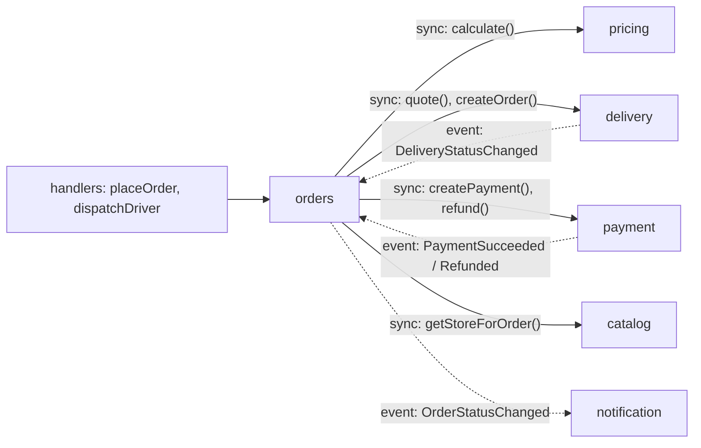
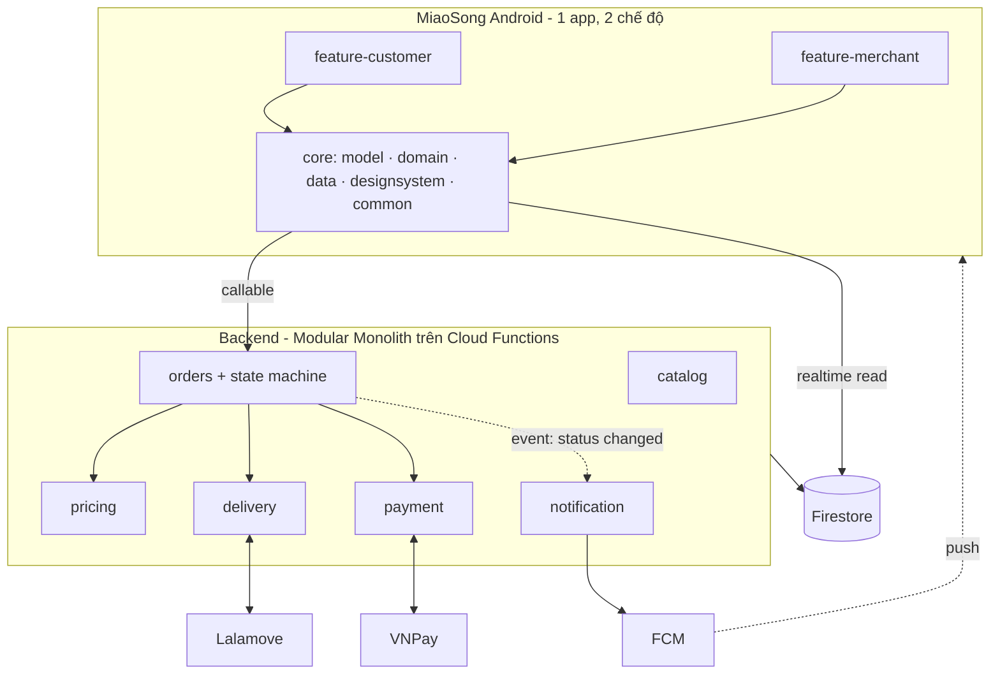
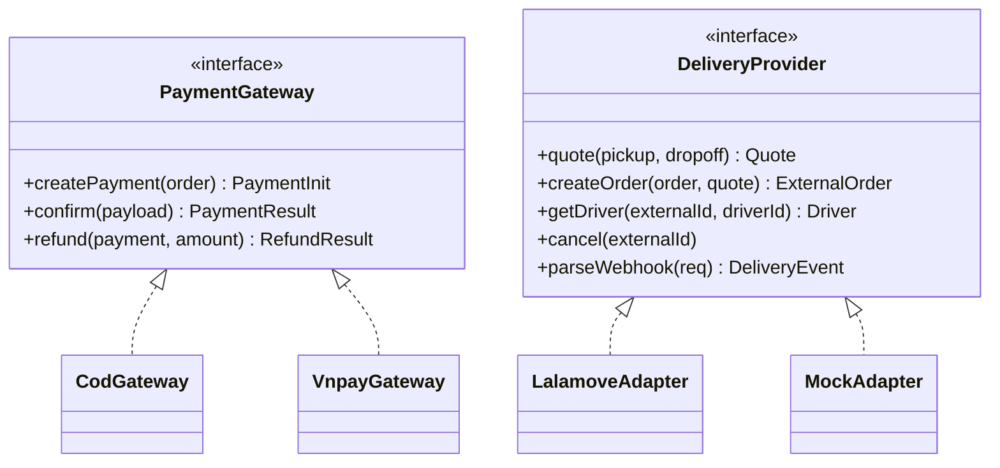
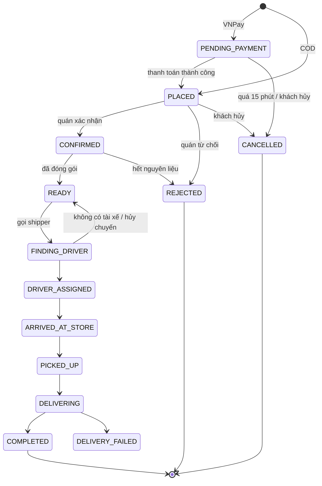
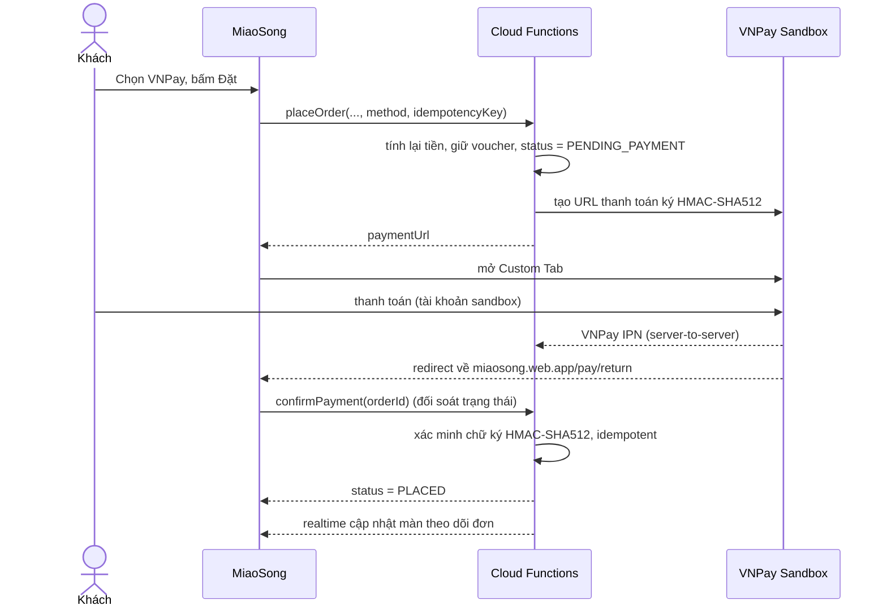
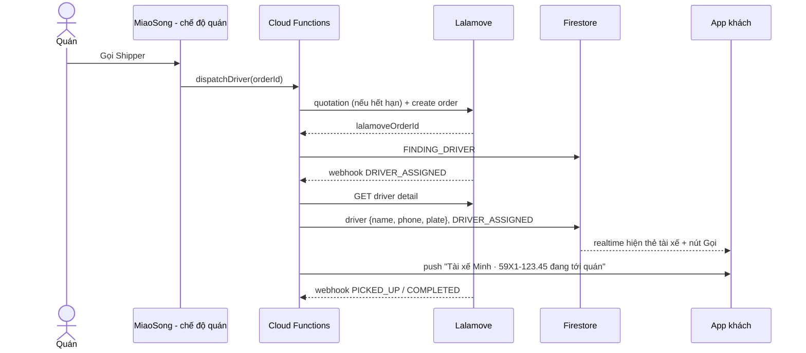
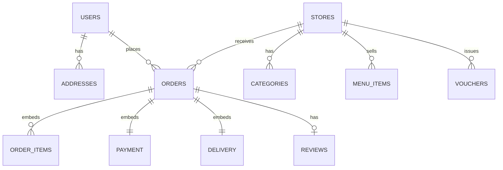

# 🐱 MiaoSong (喵送) — Master Plan v3

> Đề tài: Nền tảng đặt món & điều phối giao hàng tự động (D2C F&B) · Môn Phát triển ứng dụng di động HK1/2026-2027
> Nhóm **2 người** · **12 ngày (20/11 → 01/12/2026)** · Đầu ra: app Android tải từ CH Play
> Giao hàng: **Lalamove** (chính) · Thanh toán: **COD + VNPay sandbox**
> SRS đầy đủ: [01-SRS.md](01-SRS.md)

---

## 0. Có nên tách microservice không? → **KHÔNG.** Chọn *Modular Monolith trên Serverless*

| Tiêu chí | Microservices | Modular Monolith (Cloud Functions) ✅ |
|---|---|---|
| Nhân lực | Hợp ≥ 3 team độc lập | 2 người |
| Hạ tầng | Mỗi service: repo/DB/CI/deploy, API gateway, service discovery, message broker, tracing | 1 project Firebase, 1 lệnh deploy |
| Giao dịch dữ liệu | Đặt đơn + giữ voucher thành giao dịch phân tán (Saga) | 1 Firestore transaction |
| Debug | Lỗi lan qua mạng giữa nhiều service | Chạy toàn bộ trên Emulator |
| Chi phí | Nhiều container chạy 24/7 | Free tier, scale về 0 |
| Thời gian tốn cho "hạ tầng" | ~40% của 12 ngày | ~5% |

**Lý do chốt:** microservice giải bài toán *tổ chức* (nhiều team, scale độc lập), không phải bài toán *tính năng*. Với 2 người/12 ngày nó chỉ thêm độ phức tạp phân tán mà không đem lại lợi ích nào người chấm nhìn thấy.

**Nhưng vẫn thiết kế "sẵn sàng tách"** (điểm cộng khi bảo vệ):
- Backend chia **6 module theo domain (bounded context)**: `catalog`, `pricing`, `orders`, `delivery`, `payment`, `notification`. Module chỉ gọi nhau qua interface, **không đọc collection của module khác**.
- Giao tiếp bất đồng bộ qua **event**: đổi trạng thái đơn → Firestore trigger → `notification` gửi push. Sau này đổi trigger thành Pub/Sub là tách được.
- Mỗi Cloud Function **đã được deploy và scale độc lập** → có lợi ích vận hành của microservice mà không tốn chi phí vận hành.
- Câu trả lời khi bị hỏi: *"Kiến trúc modular monolith theo DDD; ranh giới module trùng với ranh giới service tương lai; khi tải tăng thì tách `delivery` và `payment` trước vì hai module này phụ thuộc bên thứ ba."*

### 0.1 Modular Monolith cụ thể trông như thế nào

**Định nghĩa:** 1 codebase, 1 lần deploy, 1 database, nhưng bên trong chia thành các module **độc lập như các service** — mỗi module có ranh giới, dữ liệu và API công khai riêng. Bên trong mỗi module dùng **Hexagonal (Ports & Adapters)**.

```
backend/functions/src/
├── modules/
│   ├── catalog/            # menu, store, trạng thái quán
│   ├── pricing/            # tính tiền, voucher (thuần logic, không I/O)
│   ├── orders/             # đặt đơn, state machine  ← module trung tâm
│   ├── delivery/           # Lalamove, Mock
│   ├── payment/            # COD, VNPay
│   └── notification/       # FCM
│       Mỗi module có cấu trúc:
│       ├── index.ts        # PUBLIC API — thứ duy nhất module khác được import
│       ├── domain/         # entity, value object, rule (không phụ thuộc Firebase)
│       ├── application/    # use case: PlaceOrder, DispatchDriver...
│       ├── ports/          # interface: OrderRepository, DeliveryProvider, PaymentGateway
│       ├── adapters/       # Firestore repo, LalamoveAdapter, VnpayGateway
│       └── handlers/       # onCall / onRequest / trigger (lớp mỏng, chỉ parse + gọi use case)
├── shared/                 # kernel dùng chung: Money, Result, errors, idempotency, logger
└── index.ts                # export toàn bộ Cloud Functions
```

**4 luật bắt buộc** (ghi vào README, kiểm tra tự động bằng `dependency-cruiser` trong CI):
| Luật | Nội dung |
|---|---|
| R1 — Public API | Module chỉ import `modules/<x>/index.ts` của module khác, cấm import sâu vào `domain/`, `adapters/` |
| R2 — Sở hữu dữ liệu | Mỗi collection có đúng 1 module chủ: `stores`, `menuItems` → catalog; `vouchers` → pricing; `orders` → orders; `processedEvents` → module nhận webhook. Module khác muốn dữ liệu phải gọi API |
| R3 — Hướng phụ thuộc | `handlers → application → domain`; `adapters` implement `ports`; `domain` không import Firebase SDK |
| R4 — Không phụ thuộc vòng | `orders` gọi `pricing`, `delivery`, `payment`; ba module này **không** gọi ngược `orders` mà phát **event** |

**Giao tiếp giữa module:**


- **Đồng bộ:** gọi hàm qua public API (in-process, không qua mạng) — trong microservice sẽ thành REST/gRPC.
- **Bất đồng bộ:** domain event qua một `EventBus` nội bộ đơn giản; `OrderStatusChanged` đi qua Firestore trigger `onDocumentUpdated(orders/{id})`. Muốn tách service: thay `EventBus` bằng **Pub/Sub**, thay lời gọi hàm bằng HTTP — logic nghiệp vụ không đổi.

> [!TIP]
> Phía Android cũng theo đúng tinh thần này: `feature-customer`, `feature-merchant` không phụ thuộc nhau, chỉ phụ thuộc `core:*` → cùng một câu chuyện kiến trúc "modular" từ app tới backend khi bảo vệ.

---

## 1. Thương hiệu MiaoSong

**MiaoSong — 喵送 (Miāo Sòng)**, đặt theo cách đặt tên của **京东 Jingdong (JD)**:
- **喵 Miāo** = tiếng mèo kêu "meo" → linh vật mèo (JD có chó Joy, Tmall có mèo đen; mình có **mèo shipper**).
- **送 Sòng** = "giao, đưa tận nơi" (như 送外卖 *giao đồ ăn*) → tên nói luôn việc app làm: **"Mèo giao món"**.
- Với người Việt, "Song" còn đọc gần "xong" → *"Meo một tiếng là xong"*. Tên mang 2 nghĩa: tiếng Trung là "giao", tiếng Việt là "xong".

- **Câu chuyện thương hiệu:** *"Meo một tiếng, món tới tận nơi."* Linh vật là **chú mèo mướp cam đội nón shipper** tên **Miu** → dùng cho icon, sticker, empty state, màn chờ tìm tài xế.
- **Tagline:** **"Meo một tiếng, món tới liền."** (dự phòng: "Quán quen, Miao là Song!")
- **Câu nói tự nhiên:** *"Miao đi!"*, *"Tối nay MiaoSong không?"*
- **Logo:** tô bún với 2 tai mèo trên miệng tô, 3 làn khói bốc lên làm thành **ria mèo**; dạng chữ có thể kèm chữ Hán 喵送 nhỏ phía dưới.
- **Màu chủ đạo:** cam mèo mướp — vừa là màu thức ăn kích thích vị giác vừa là màu của linh vật.
- **Định danh kỹ thuật:** app name `MiaoSong`, applicationId `vn.miaosong.app`, deep link `https://miaosong.web.app/s/{slug}` (domain miễn phí của Firebase Hosting), scheme `miaosong://`.

---

## 2. Quyết định Senior (đã điều chỉnh cho nhóm 2 người)

1. **1 app Android duy nhất, phân quyền theo vai trò** (như Shopee có "Kênh Người Bán" trong cùng app). Đăng nhập tài khoản quán → mở *Chế độ Quán*; tài khoản thường → *Chế độ Khách*. Chỉ cần **1 lần làm store listing, 1 bộ CI**; vẫn tách rõ `feature-customer` / `feature-merchant` để sau này tách thành 2 app bằng product flavor.
2. **Modular monolith serverless** (mục 0).
3. **Không có secret trong APK** — Lalamove, VNPay đều gọi qua Cloud Functions.
4. **Server là nguồn sự thật về giá**; dùng chung test vector JSON cho Kotlin & TypeScript.
5. **Tiền = `Long` VND.** Toàn bộ hệ thống thống nhất dùng số nguyên VND, không dùng `Double`.
6. **Strategy cho cả Delivery và Payment** → thêm provider không phải sửa luồng đặt đơn.
7. **MockDeliveryProvider** song song với Lalamove: sandbox không có tài xế thật nên cần giả lập để demo trọn luồng.
8. **State machine đơn hàng + webhook idempotent + snapshot dữ liệu vào đơn.**
9. **Cắt việc không cần backend:** cảnh báo đơn trễ và trạng thái quán hiệu lực được **tính ở client** từ timestamp → không cần cron cho các việc này.

---

## 3. Phạm vi (MoSCoW, đã cắt cho 2 người)

| Mức | Nội dung |
|---|---|
| **Must** | Toàn bộ 5 nhóm nghiệp vụ của đề · Lalamove sandbox (báo giá + tạo chuyến + webhook) · MockProvider · COD · VNPay (thanh toán + IPN + hoàn tiền) · push FCM · đánh giá · đặt lại |
| **Should** | Deep link mở thẳng quán · khách tự hủy đơn khi quán chưa nhận · tự hủy đơn chưa thanh toán sau 15 phút · dark mode |
| **Could** | Thống kê doanh thu ngày · bản đồ vị trí tài xế · bố cục tablet ngang cho màn bếp · đăng nhập OTP |
| **Won't** | AhaMove (chỉ để sẵn interface), chat, web admin, iOS, đa ngôn ngữ, microservices |

---

## 4. Actor

| Actor | Loại | Vai trò |
|---|---|---|
| Khách hàng | Primary | Duyệt menu, tùy chỉnh, đặt, thanh toán, theo dõi, đánh giá, đặt lại |
| Quán (MERCHANT) | Primary | Đại diện toàn bộ phía quán (chủ quán, thu ngân, bếp dùng chung 1 vai trò hệ thống): menu, voucher, nhận/từ chối đơn, màn bếp (KDS), gọi shipper, trạng thái & lịch quán |
| Lalamove | Secondary | Báo giá, tạo chuyến, webhook tài xế/trạng thái |
| VNPay | Secondary | Thanh toán nội địa, IPN, hoàn tiền |
| Google Maps API | Secondary | Places Autocomplete, Geocoding, Maps SDK |
| FCM | Secondary | Push notification |
| Bộ lập lịch | Time actor | Hủy đơn chưa thanh toán quá hạn |

---

## 5. Tech Stack

### Android
| Hạng mục | Lựa chọn |
|---|---|
| Ngôn ngữ / UI | Kotlin 2.x · Jetpack Compose · Material 3 |
| Kiến trúc | Clean Architecture + MVVM (UDF: `UiState` + `StateFlow` + event một chiều) |
| DI · Async | Hilt · Coroutines/Flow |
| Điều hướng | Navigation Compose type-safe, 2 nav graph theo role, deep link |
| Local | Room (giỏ hàng) · DataStore (cài đặt, role) |
| Mạng | Firebase SDK (Firestore, Functions callable, Auth, Storage, FCM) · Google Maps SDK / Places SDK |
| Thanh toán | **Chrome Custom Tabs** mở URL thanh toán VNPay → quay về bằng App Link `miaosong.web.app/pay/return` |
| Ảnh · Bản đồ | Coil 3 · Maps Compose + Google Places / Geocoding API |
| Nền | Foreground Service (chế độ quán khi đang mở cửa) · WorkManager |
| Chất lượng | Crashlytics · ktlint · JUnit · MockK · Turbine · Compose UI test |
| Build | Version Catalog · minSdk 26 · **targetSdk 36** · R8 · GitHub Actions → AAB |

### Backend
| Hạng mục | Lựa chọn |
|---|---|
| Nền tảng | Firebase (Blaze, nằm trong free tier, có đặt budget alert) |
| Logic | Cloud Functions 2nd gen, TypeScript, `asia-southeast1` |
| DB | Firestore (realtime) |
| Hosting | Firebase Hosting: privacy policy, trang return thanh toán, `assetlinks.json` cho App Link |
| Đối tác | Lalamove API v3 (sandbox, market VN) · VNPay sandbox (HMAC-SHA512) · Google Maps API |
| Dev | Firebase Emulator Suite · `ngrok` để nhận webhook khi chạy local |

---

## 6. Kiến trúc



**Quy tắc ghi:** client chỉ ghi trực tiếp hồ sơ, địa chỉ, menu/voucher/trạng thái quán (chủ quán, kiểm soát bằng Security Rules + custom claims `role`, `storeId`). **Mọi ghi vào `orders` chỉ qua Cloud Functions.**

### Cấu trúc repo
```
miaosong/
├── android/
│   ├── app/                       # entry, role router, DI graph
│   ├── feature-customer/          # home, store, item sheet, cart, checkout, payment, tracking, history, review
│   ├── feature-merchant/          # inbox, kitchen, dispatch, menu, voucher, store status, schedule, reviews
│   ├── core/model · core/domain · core/data · core/designsystem · core/common
├── backend/functions/src/
│   ├── modules/    catalog · pricing · orders · delivery (lalamove, mock) · payment (cod, vnpay) · notification
│   │               mỗi module: index.ts · domain/ · application/ · ports/ · adapters/ · handlers/  (xem §0.1)
│   └── shared/     money.ts · result.ts · errors.ts · idempotency.ts · eventBus.ts
├── shared/test-vectors/pricing.json
└── docs/           SRS · diagrams (PlantUML) · báo cáo · slide
```

---

## 7. Design Patterns

| Pattern | Áp dụng |
|---|---|
| Clean Architecture / MVVM / UDF | Mọi màn hình |
| Repository · Use Case | `MenuRepository`, `CartRepository`, `PlaceOrderUseCase`, `ReorderUseCase`... |
| **Strategy + Adapter** | `DeliveryProvider` (Lalamove, Mock) · `PaymentGateway` (COD, VNPay) |
| Factory | `DeliveryProviderFactory`, `PaymentGatewayFactory` |
| State | `OrderStateMachine` |
| Observer | Firestore snapshot → Flow → Compose |
| Specification | Điều kiện voucher kết hợp AND |
| Value Object | `Money`, `CartLineKey` |
| Idempotency Key | `placeOrder`, webhook Lalamove, IPN VNPay |
| Domain Events | `OrderStatusChanged` → notification (chỗ để tách service sau này) |



---

## 8. Nghiệp vụ lõi

### 8.1 Giỏ hàng tách dòng
`CartLineKey = sha1(menuItemId + sizeOptionId + sorted(toppingIds) + normalize(note))` → trùng key mới cộng SL; "không hành" và "nhiều hành" là 2 dòng.

### 8.2 Công thức tiền (server tính lại)
$$
\text{total} = \underbrace{\sum_i(\text{giá size}_i + \sum\text{topping}_i)\times SL_i}_{\text{subtotal}} - \min(\text{discount}, \text{subtotal}) + \text{shippingFee}
$$
Voucher không trừ vào phí ship; tổng hóa đơn không âm.

### 8.3 Lalamove
- Ký mỗi request bằng HMAC-SHA256 (`apiKey:secret`), header `Market: VN`, `serviceType: MOTORCYCLE`.
- `POST /v3/quotations` → `quotationId`, `priceBreakdown.total`, `distance`, hết hạn ~5 phút.
- Khi gọi shipper: quote hết hạn → báo giá lại (chênh lệch quán chịu) → `POST /v3/orders`.
- Webhook `DRIVER_ASSIGNED` → gọi `GET /v3/orders/{id}/drivers/{driverId}` lấy **tên, SĐT, biển số**; `ORDER_STATUS_CHANGED` → map trạng thái.
- Thu hộ COD: kiểm tra Lalamove VN có hỗ trợ thu hộ qua API ở D1; nếu không → ghi số tiền thu hộ vào ghi chú cho tài xế (ghi rõ hạn chế này trong báo cáo).

### 8.4 State machine đơn hàng


`refundStatus`: `NONE → PENDING → REFUNDED | FAILED` — tự kích hoạt khi đơn đã trả online bị REJECTED/CANCELLED.

### 8.5 Luồng thanh toán online (VNPay Sandbox)


Hoàn tiền: VNPay `refund` API (`merchant_webapi`).

### 8.6 Gọi shipper & đồng bộ tài xế



### 8.7 Trạng thái quán & chuông
- `effectiveStatus` tính ở client: Đóng thủ công > Ngày đặc biệt > Bận còn hạn (`busyUntil`) > Lịch tuần. Server kiểm tra lại khi `placeOrder`.
- Chuông: FCM high-priority data message → Notification Channel `new_order` âm thanh riêng; Foreground Service lắng nghe Firestore khi quán đang mở cửa.

---

## 9. Data Model (Firestore)



| Collection | Trường chính |
|---|---|
| `users/{uid}` | name, phone, role (`CUSTOMER`/`MERCHANT`), storeId?, fcmTokens[] |
| `users/{uid}/addresses` | label, fullText, lat, lng, note, isDefault |
| `stores/{id}` | name, slug, address, lat, lng, phone, manualStatus, busyUntil, weeklySchedule, specialDays[], maxDistanceKm, ratingAvg, ratingCount |
| `stores/{id}/categories` | name, sortOrder |
| `stores/{id}/menuItems` | categoryId, name, description, imageUrl, basePrice, isAvailable, optionGroups[{id, name, type SINGLE/MULTI, required, min, max, options[{id, name, priceDelta, isAvailable}]}] |
| `stores/{id}/vouchers` | code, type PERCENT/FIXED, value, maxDiscount, minOrder, startAt, endAt, usageLimit, usedCount, perUserLimit, isActive |
| `orders/{id}` | code `MS-241120-0012`, customerId, storeId, items[snapshot], pricing{subtotal, discount, shippingFee, total}, voucherCode, address, **payment{method COD/VNPAY, status, amountVnd, gatewayTxnId}**, refundStatus, status, statusHistory[], delivery{provider, quotationId, quoteExpiresAt, externalId, driver{name, phone, plate}, shareLink}, rejectReason, idempotencyKey, createdAt |
| `reviews/{orderId}` | storeId, customerId, stars, comment, tags[] |
| `processedEvents/{id}` | source (LALAMOVE/VNPAY), receivedAt |
| `config/payment` | pendingPaymentTtlMin |

---

## 10. UI/UX (nguyên tắc impeccable)

### Design token
| Token | Giá trị | Dùng cho |
|---|---|---|
| Primary — *Cam mèo mướp* | `oklch(0.68 0.16 50)` ≈ `#E97A2E` | CTA, giá, linh vật (~10% diện tích) |
| Primary đậm (chữ trên nền sáng) | `oklch(0.52 0.15 45)` ≈ `#B4521A` | đảm bảo tương phản AA |
| Secondary — *Xanh rau thơm* | `oklch(0.56 0.11 145)` ≈ `#4C8B4F` | "Đang mở", thành công |
| Accent — *Vàng chả* | `oklch(0.84 0.12 85)` ≈ `#EDC15A` | ghi chú đặc biệt, voucher |
| Cảnh báo dị ứng | `oklch(0.55 0.19 27)` ≈ `#C8372D` | màn bếp |
| Nền *Giấy kem* | `oklch(0.98 0.01 80)` ≈ `#FBF7F1` | không dùng trắng tinh |
| Chữ *Nâu than* | `oklch(0.26 0.02 50)` ≈ `#3B2F29` | không dùng đen tuyền |
| Font | **Be Vietnam Pro**, số tiền dùng tabular figures | |
| Spacing / bo góc | thang 4dp · card 12dp · sheet 20dp · chip tròn | |
| Motion | 150–250ms, ease-out-quart, không bounce | |

### Checklist audit (chạy ở D11)
- Không gradient tím, không chữ gradient, không glassmorphism, không card lồng card, không lưới card giống hệt nhau, không chữ xám trên nền màu.
- Touch ≥ 48dp (màn bếp ≥ 64dp), tương phản ≥ 4.5:1, font scale 200%, TalkBack.
- Mỗi màn đủ **loading (skeleton) · empty (mèo minh họa) · error (có thử lại) · success**.
- CTA chính ở thanh dưới, vùng ngón cái.
- Microcopy giọng mèo thân thiện: *"Meo~ quán đang nấu cho bạn nè"*, *"Hết chả cá mất rồi, quán xin lỗi nha 😿"*, *"Ship 18.000đ · 3,2 km"*.

### Màn hình
**Chế độ Khách (12 màn):** Onboarding · Đăng nhập · Home · Trang quán (tab nhóm món sticky) · Bottom sheet tùy chỉnh · Giỏ hàng · Checkout (địa chỉ, báo giá ship, voucher, COD/VNPay, bảng tiền) · Kết quả thanh toán · Theo dõi đơn (timeline + thẻ tài xế) · Lịch sử · Đánh giá · Hồ sơ & địa chỉ.

**Chế độ Quán (9 màn):** Inbox đơn (Mới/Đang làm/Chờ ship/Đang giao) · Chi tiết đơn + từ chối có lý do · **Màn bếp** · Gọi shipper & theo dõi (badge đỏ khi trễ) · Menu & option group · Voucher · Trạng thái quán 1 chạm · Lịch hoạt động · Đánh giá.

Công cụ: **Stitch MCP** (đã kết nối) để dựng mockup từ token → code Compose.

---

## 11. Chia việc 2 người

| | **P1 — Backend & Chế độ Quán (vận hành đơn)** | **P2 — Android Khách & Design System** |
|---|---|---|
| Backend | Firebase, Rules, custom claims, seed data · pricing + voucher + test vectors · placeOrder, state machine · Lalamove adapter + webhook + Mock simulator · VNPay + IPN + refund · FCM trigger · scheduler hủy đơn chưa thanh toán | — |
| Android | Chế độ Quán phần đơn hàng: inbox + chuông + foreground service, chi tiết/xác nhận/từ chối, màn bếp, gọi shipper & theo dõi | `core:designsystem`, auth & role router · toàn bộ Chế độ Khách · Chế độ Quán phần CRUD: menu & option group, voucher, trạng thái & lịch, xem đánh giá |
| Release | Ký app, AAB, CI, Play Console | Store listing, ảnh, privacy policy |
| Tài liệu | Kiến trúc, sequence, state, ERD, API | Use case, đặc tả, UI/UX, test case, slide, video demo |

**Hợp đồng chung chốt ngay D1–D2** để 2 người làm song song không chờ nhau: `core:model` (data class), schema Firestore, tên + input/output các callable và mã lỗi (đã có ở SRS §8). P2 dùng **Firebase Emulator + seed data** nên không phải chờ backend xong.

Quy trình: branch theo tính năng, PR nhỏ, người kia review trong ngày; sync 15 phút mỗi tối; demo nội bộ D5, D9.

---

## 12. Timeline 12 ngày

| Ngày | Mốc | P1 — Backend & Quán (đơn) | P2 — Khách & Design |
|---|---|---|---|
| **D1** 20/11 | Kick-off | **Đăng ký Lalamove sandbox, VNPay sandbox, Google Maps API Key, Play Console**; tạo Firebase, repo, CI | Design token, mockup 6 màn chính trên Stitch; chốt `core:model` cùng P1 |
| **D2** 21/11 | Nền móng | Schema, Security Rules, custom claims, seed 2 quán | `core:designsystem`, Auth, role router, nav graph |
| **D3** 22/11 | | `pricing.ts` + voucher + test vectors | Home, trang quán, bottom sheet tùy chỉnh |
| **D4** 23/11 | | Lalamove quotation + MockProvider, `getDeliveryQuote` | Giỏ hàng Room + CartLineKey, địa chỉ + Google Maps API |
| **D5** 24/11 | **Demo #1**: đặt COD | `placeOrder` (idempotency, transaction voucher) | Checkout: báo giá ship, voucher, bảng tiền, COD |
| **D6** 25/11 | | State machine, confirm/reject, FCM trigger; **Inbox + chuông** | Menu CRUD + option group (chế độ quán) |
| **D7** 26/11 | | VNPay create / IPN / refund; chi tiết đơn + từ chối | Theo dõi đơn (timeline), xử lý push; voucher CRUD |
| **D8** 27/11 | | Hoàn thiện VNPay refund; **màn bếp (KDS)** | Custom Tab + App Link return; màn kết quả thanh toán |
| **D9** 28/11 | **Demo #2**: end-to-end | Lalamove create order + webhook + driver detail; màn gọi shipper | Thẻ tài xế, lịch sử, đặt lại; trạng thái & lịch quán |
| **D10** 29/11 | **Feature freeze** | Mock simulator, scheduler, rules hardening, cảnh báo trễ | Đánh giá + xem đánh giá; empty/error states |
| **D11** 30/11 | Polish & release | AAB release, upload **Internal testing**, test máy thật | **Impeccable audit → polish**, store listing, bug bash |
| **D12** 01/12 | Nộp bài | Báo cáo kỹ thuật, diagram | Slide, video demo, test case |

**Nếu trễ, cắt theo thứ tự:** thống kê → deep link → ngày đặc biệt trong lịch (chỉ giữ lịch tuần) → tự hủy đơn chưa thanh toán.

---

## 13. Phát hành CH Play

> [!WARNING]
> Tài khoản Play cá nhân mới tạo bắt buộc **closed testing ≥ 12 tester × 14 ngày** trước khi lên Production → không kịp trong 12 ngày. Phát hành qua **Internal testing** (link tải trực tiếp từ CH Play, duyệt gần như ngay). Đăng ký tài khoản (25 USD) **ngay D1** vì xác minh danh tính mất 1–3 ngày.

Checklist: Play App Signing · AAB · targetSdk 36 · privacy policy trên Firebase Hosting · Data safety (vị trí, SĐT, thông tin thanh toán do bên thứ ba xử lý) · content rating · icon 512 · feature graphic 1024×500 · ≥ 4 screenshot · tài khoản demo khách & quán cho người chấm.

---

## 14. Rủi ro

| Rủi ro | Ứng phó |
|---|---|
| Lalamove sandbox cấp key chậm / không có tài xế | Đăng ký D1; MockProvider + simulator đẩy webhook giả theo đúng format Lalamove |
| Lalamove VN không thu hộ COD qua API | Ghi tiền thu hộ vào ghi chú tài xế; nêu rõ trong báo cáo |
| Webhook không gọi được về máy local | Deploy Functions lên Firebase thật; dùng ngrok khi debug |
| Không bật được Blaze | Express trên Render free + Admin SDK (cùng code module) |
| FCM trễ, chuông không kêu | Foreground Service + Firestore listener |
| 1 người ốm / kẹt | Hợp đồng `core:model` + Emulator giúp người kia tiếp tục; cắt theo danh sách ở §12 |

---

## 15. Definition of Done & Kiểm thử
- **DoD:** chạy trên máy thật · đủ trạng thái UI · logic domain có unit test · PR được review · SRS cập nhật nếu đổi nghiệp vụ.
- **Unit:** PricingCalculator, VoucherValidator, CartLineKey, OrderStateMachine, effectiveStatus.
- **Integration (Emulator):** 2 đơn đồng thời tranh 1 lượt voucher; webhook lặp 3 lần; IPN sai chữ ký.
- **Kịch bản demo:** 2 tô "không hành"/"nhiều hành" + voucher 10% → thanh toán VNPay → quán reo chuông → xác nhận → bếp → gọi Lalamove → tài xế hiện → push từng bước → hoàn thành → đánh giá → đặt lại. Kịch bản phụ: đơn VNPay → quán từ chối "Hết chả cá" → hoàn tiền VNPay tự động.

---

## 16. Thiết bị & cách demo (2 điện thoại thật)

| Thiết bị | Vai trò khi demo | Vai trò khi dev |
|---|---|---|
| 📱 Điện thoại 1 | Tài khoản **khách** — đặt món, thanh toán, nhận push, xem tài xế | Máy test chính của P2 |
| 📱 Điện thoại 2 | Tài khoản **chủ quán** — chuông, màn bếp, gọi shipper | Máy test chính của P1 (chuông, foreground service, push phải test trên máy thật) |
| 💻 Emulator trên laptop | Chiếu màn **bảng điều khiển Mock simulator** (đẩy trạng thái tài xế) hoặc màn bếp thứ 2 | Test nhanh UI, font scale, dark mode |

Lưu ý: nên có 1 máy Android 13+ để test quyền thông báo `POST_NOTIFICATIONS`; tắt tối ưu pin cho app trên máy quán (Xiaomi/Oppo hay chặn chạy nền). Khi demo, dùng **scrcpy** chiếu cả 2 điện thoại lên màn hình máy chiếu.

---

## ✅ Đã chốt
- Tên: **MiaoSong (喵送)** · 1 app 2 chế độ · Modular monolith backend · Lalamove · COD + VNPay sandbox · 2 người · 2 điện thoại thật · có thẻ thanh toán.

## ❓ Còn cần xác nhận
1. Nhóm muốn mình **bắt tay vào dựng khung dự án ngay** (Gradle multi-module + Functions theo cấu trúc modular + design system + seed data) không?
2. Tên GitHub repo và tên 2 thành viên (để ghi vào README / phân công)?


