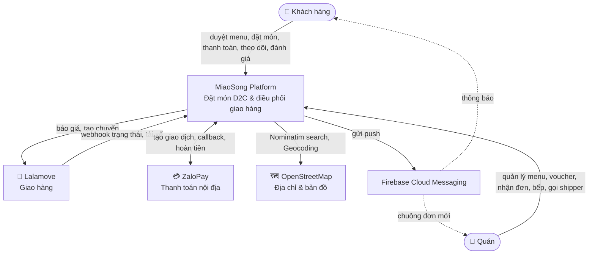
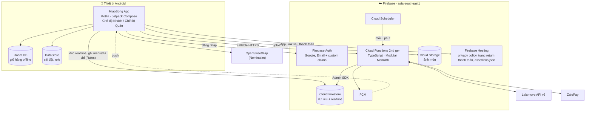
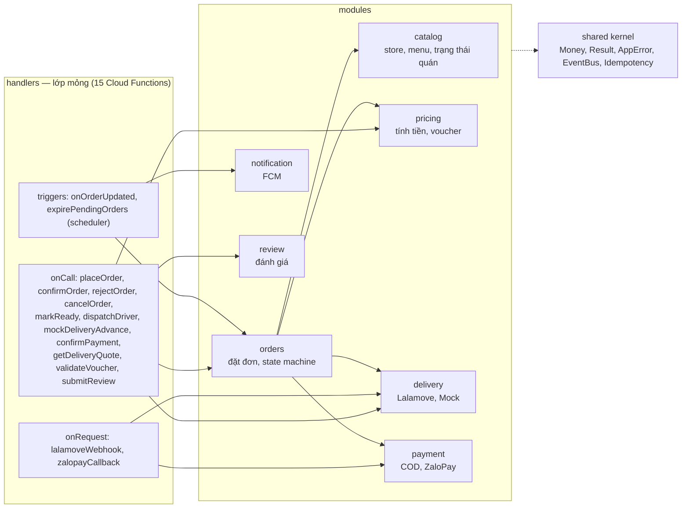
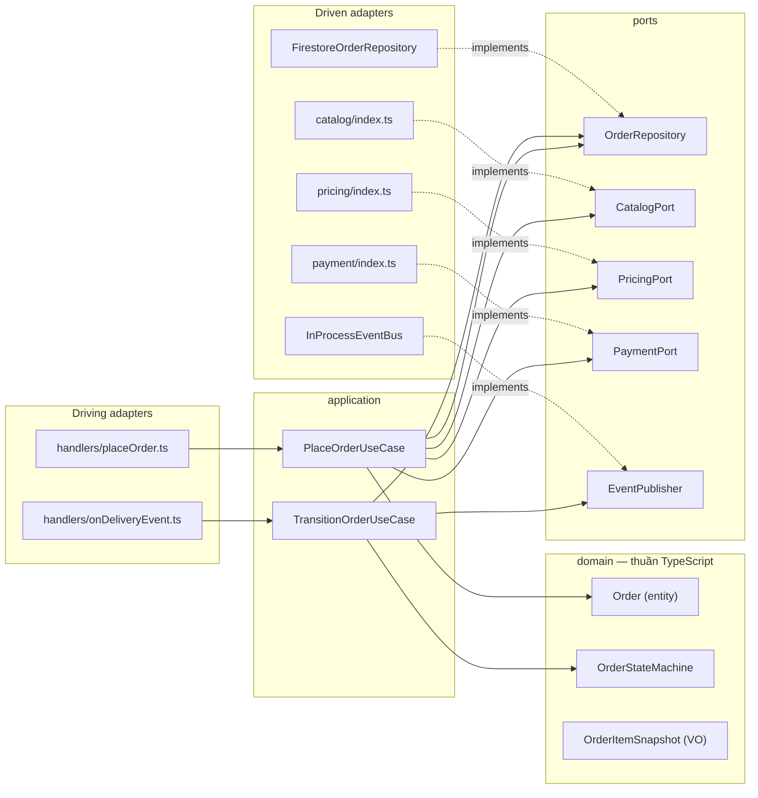
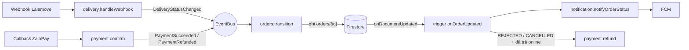
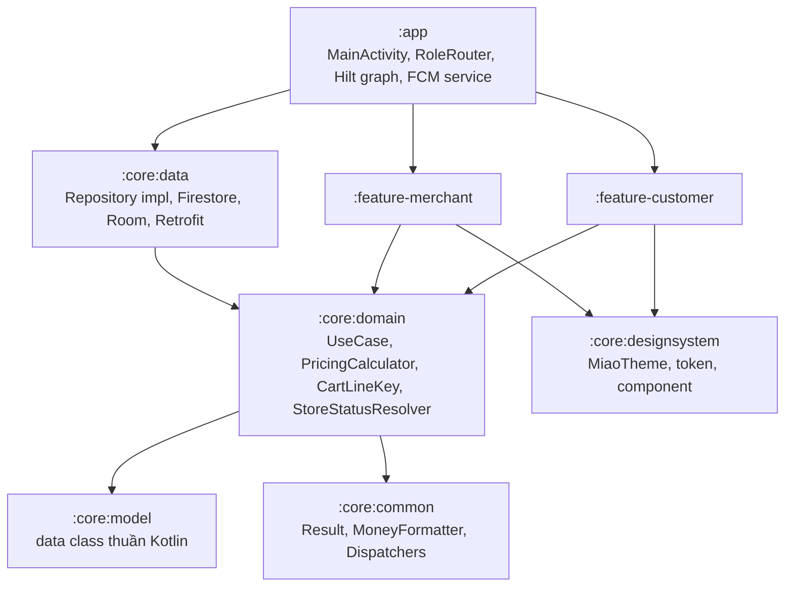
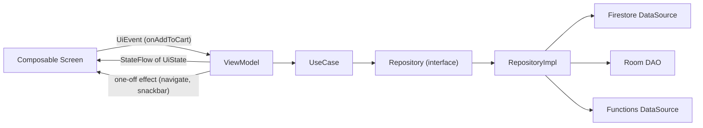
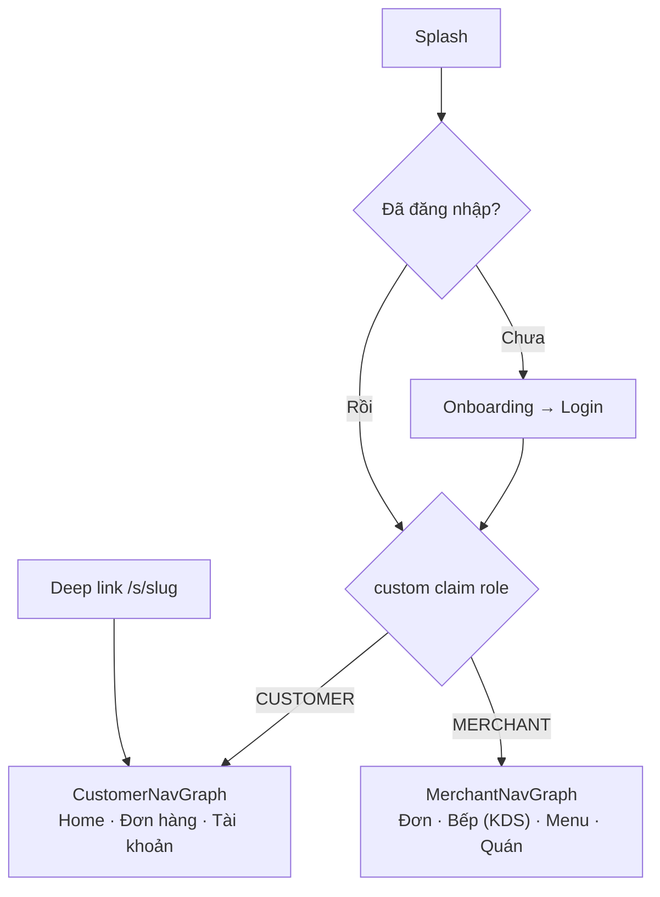
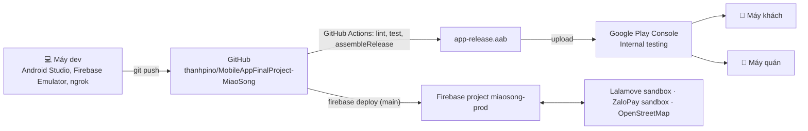

# 02 — Kiến trúc hệ thống MiaoSong

> Người phụ trách: **Trương Minh Thành** · Review: **Huỳnh Trần Thiên Phú**
> Liên quan: [01-SRS.md](01-SRS.md) · [03-use-case-diagrams.md](03-use-case-diagrams.md) · [04-sequence-diagrams.md](04-sequence-diagrams.md) · [05-activity-diagrams.md](05-activity-diagrams.md) · [06-state-data-class.md](06-state-data-class.md) · [07-test-plan.md](07-test-plan.md) · [08-api-contract.md](08-api-contract.md)

## Mục lục
1. [Quyết định kiến trúc (ADR)](#1-quyết-định-kiến-trúc-adr)
2. [C4 Level 1 — System Context](#2-c4-level-1--system-context)
3. [C4 Level 2 — Container](#3-c4-level-2--container)
4. [Backend — Modular Monolith (Component)](#4-backend--modular-monolith-component)
5. [Bên trong một module — Hexagonal](#5-bên-trong-một-module--hexagonal)
6. [Luồng sự kiện giữa module](#6-luồng-sự-kiện-giữa-module)
7. [Kiến trúc Android](#7-kiến-trúc-android)
8. [Deployment](#8-deployment)
9. [Kiến trúc bảo mật](#9-kiến-trúc-bảo-mật)
10. [Cấu trúc thư mục](#10-cấu-trúc-thư-mục)

---

## 1. Quyết định kiến trúc (ADR)

| ID | Quyết định | Lý do | Phương án đã loại |
|---|---|---|---|
| ADR-01 | **Modular Monolith** trên Cloud Functions | 2 người / 12 ngày; giao dịch đặt đơn + voucher cần 1 transaction; không tốn chi phí vận hành | Microservices (quá tải hạ tầng, giao dịch phân tán) |
| ADR-02 | **1 app Android, 2 chế độ** theo role | 1 store listing, 1 CI; giống "Kênh Người Bán" của Shopee | 2 app riêng (gấp đôi công phát hành) |
| ADR-03 | **Firestore** làm DB + kênh realtime | Snapshot listener thay cho WebSocket tự viết | PostgreSQL + Socket.IO (phải tự host) |
| ADR-04 | **Mọi ghi vào `orders` qua Cloud Functions** | Server là nguồn sự thật về giá & trạng thái | Client ghi trực tiếp (dễ gian lận giá) |
| ADR-05 | **Strategy + Adapter** cho Delivery và Payment | Thêm Lalamove/Mock, COD/ZaloPay không sửa luồng đặt đơn | `if/else` theo provider |
| ADR-06 | **MockDeliveryProvider** song song Lalamove | Sandbox không có tài xế thật → demo vẫn trọn luồng | Chỉ dùng sandbox |
| ADR-07 | **Tiền = số nguyên VND** (`Long` / `number` integer) | Tránh sai số dấu phẩy động | `Double` |
| ADR-08 | **Clean Architecture + MVVM (UDF)** trên Android | Tách UI khỏi logic, test được ViewModel/UseCase | MVC / logic trong Composable |
| ADR-09 | **Idempotency** cho `placeOrder`, webhook, IPN | Mạng chập chờn, đối tác gửi lặp | Không kiểm tra trùng |

---

## 2. C4 Level 1 — System Context



## 3. C4 Level 2 — Container



## 4. Backend — Modular Monolith (Component)



**Bảng sở hữu dữ liệu (luật R2):**

| Module | Collection sở hữu | API công khai (`index.ts`) |
|---|---|---|
| catalog | `stores`, `stores/*/categories`, `stores/*/menuItems` | `getStoreForOrder()`, `resolveItems()`, `isStoreOpen()` |
| pricing | `stores/*/vouchers`, `voucherRedemptions` | `calculate()`, `validateVoucher()`, `reserveVoucher(tx)`, `releaseVoucher(tx)` |
| orders | `orders` | `placeOrder()`, `transition()`, `getOrder()` |
| delivery | `processedEvents` (LALAMOVE) | `quote()`, `dispatch()`, `cancel()`, `handleWebhook()` |
| payment | `processedEvents` (ZALOPAY), `config/payment` | `createPayment()`, `confirm()`, `refund()` |
| notification | `users/*.fcmTokens` (đọc) | `notifyOrderStatus()` |
| review | `reviews` | `submitReview()` |

**4 luật module** (kiểm tra bằng `dependency-cruiser` trong CI):
1. **R1** — chỉ import `modules/<x>/index.ts` của module khác.
2. **R2** — mỗi collection chỉ một module được ghi.
3. **R3** — `handlers → application → domain`; `domain` không import Firebase.
4. **R4** — không phụ thuộc vòng; `delivery`/`payment` báo ngược cho `orders` bằng **event**.

## 5. Bên trong một module — Hexagonal

Ví dụ module `orders`:



## 6. Luồng sự kiện giữa module



| Event | Phát bởi | Xử lý bởi |
|---|---|---|
| `DeliveryStatusChanged` | delivery | orders |
| `PaymentSucceeded` | payment | orders (`PENDING_PAYMENT → PLACED`) |
| `PaymentRefunded` / `RefundFailed` | payment | orders (`refundStatus`) |
| `OrderStatusChanged` (Firestore trigger) | orders | notification, payment (hoàn tiền) |

> Khi cần tách microservice: `InProcessEventBus` → **Cloud Pub/Sub**, lời gọi `index.ts` → HTTP. Logic nghiệp vụ giữ nguyên.

## 7. Kiến trúc Android

### 7.1 Module graph


`feature-customer` và `feature-merchant` **không phụ thuộc nhau**; `:core:domain` định nghĩa interface Repository, `:core:data` implement (Dependency Inversion).

### 7.2 Phân lớp trong một màn hình (UDF)



### 7.3 Điều hướng theo role



## 8. Deployment



| Môi trường | Firebase project | Đối tác |
|---|---|---|
| local | Emulator Suite | MockProvider, ZaloPay sandbox qua ngrok |
| prod (demo) | `miaosong-prod` | Lalamove sandbox + Mock, ZaloPay sandbox, OpenStreetMap |

## 9. Kiến trúc bảo mật

| Lớp | Biện pháp |
|---|---|
| Danh tính | Firebase Auth; role (`CUSTOMER` / `MERCHANT`) & `storeId` lưu trong **custom claims** (chỉ Functions set) |
| Dữ liệu | Firestore Rules: khách đọc `orders` có `customerId == uid`; quán đọc `orders` có `storeId == token.storeId`; **client không ghi `orders`, `vouchers.usedCount`, `reviews` trực tiếp** |
| Secret | API key Lalamove/ZaloPay (`key1`, `key2`) trong **Secret Manager** (`defineSecret`), không có trong APK |
| Webhook | Lalamove: xác minh chữ ký HMAC; ZaloPay: MAC HMAC-SHA256 (`key2`) |
| Chống lặp | `processedEvents/{source_eventId}`, `idempotencyKey` của đơn |
| App | R8 obfuscation, HTTPS, App Check (Could) |

## 10. Cấu trúc thư mục

```
MiaoSong/
├── android/
│   ├── app/
│   ├── feature-customer/  (home, store, item, cart, checkout, payment, tracking, history, review, profile)
│   ├── feature-merchant/  (inbox, orderdetail, kitchen, dispatch, menu, voucher, storestatus, schedule, reviews)
│   └── core/ (model, domain, data, designsystem, common)
├── backend/functions/src/
│   ├── modules/ (catalog, pricing, orders, delivery, payment, notification, review)
│   │   └── <module>/ index.ts · domain/ · application/ · ports/ · adapters/ · handlers/
│   ├── shared/
│   └── index.ts
├── shared/test-vectors/pricing.json
└── docs/
```

