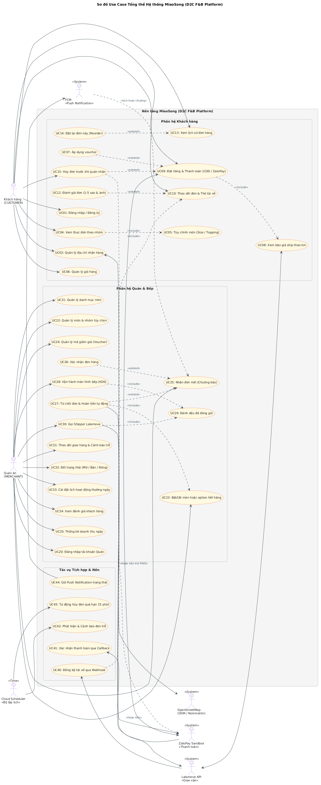
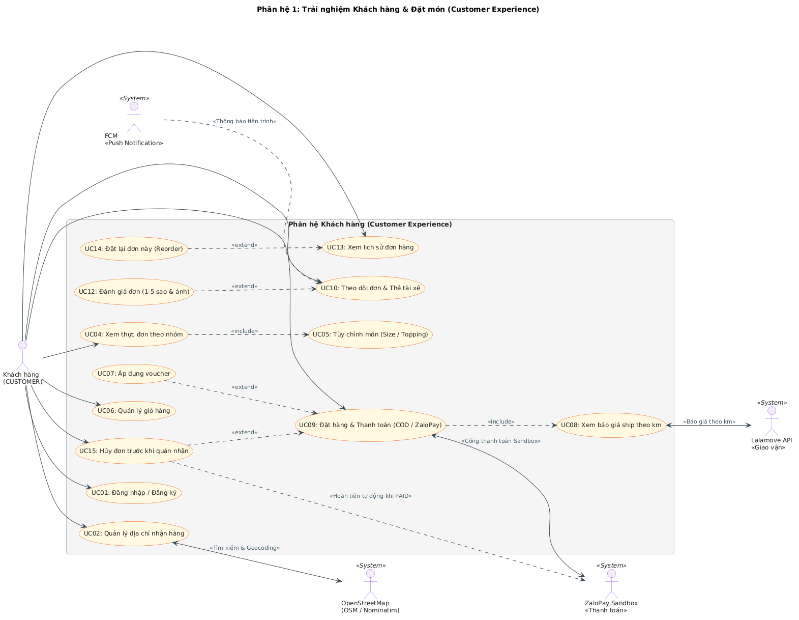
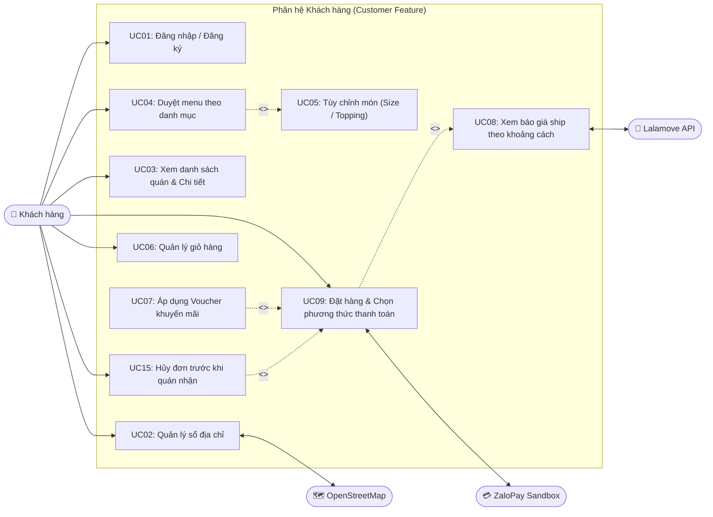
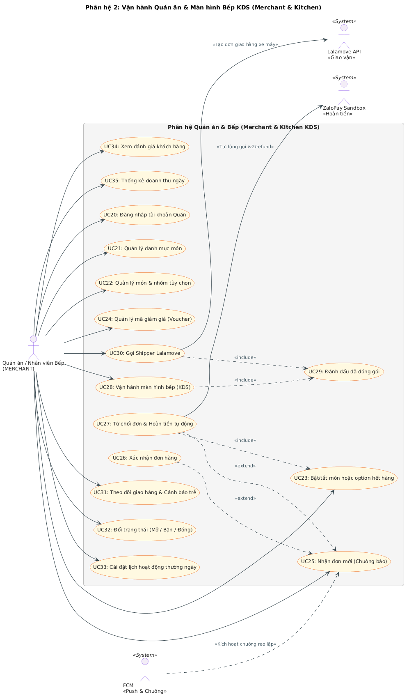
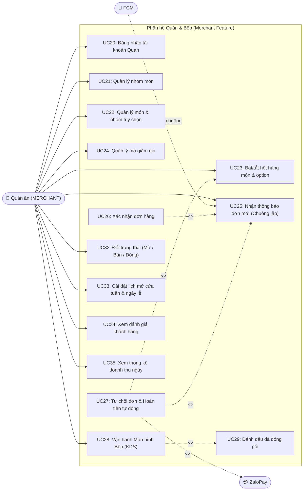
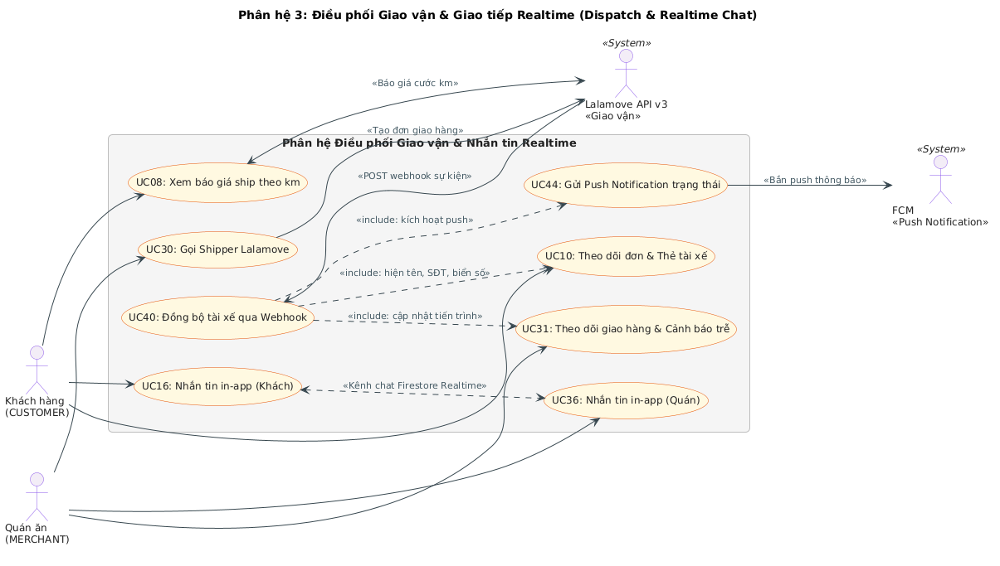
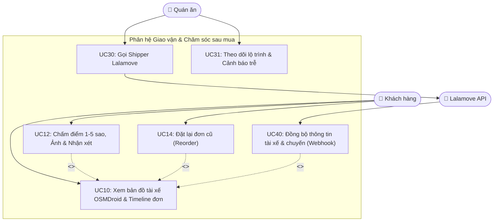
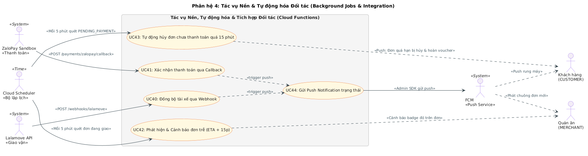
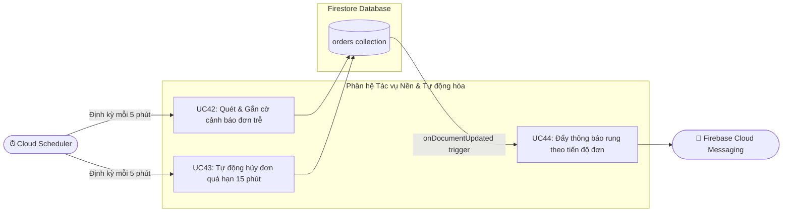

# 03 — Sơ đồ Use Case (Use Case Diagrams)

> **Dự án:** MiaoSong (喵送) — Nền tảng đặt món & điều phối giao hàng tự động (D2C F&B)  
> **Người phụ trách:** Nhóm phát triển MiaoSong  
> **Tài liệu liên quan:** [01-SRS.md](01-SRS.md) · [02-architecture.md](02-architecture.md) · [04-sequence-diagrams.md](04-sequence-diagrams.md) · [06-state-data-class.md](06-state-data-class.md)

---

## Mục lục
1. [Tổng quan Actor & Phân hệ](#1-tổng-quan-actor--phân-hệ)
2. [Sơ đồ Use Case Tổng thể (System Overview)](#2-sơ-đồ-use-case-tổng-thể-system-overview)
3. [Phân hệ 1: Trải nghiệm Khách hàng & Đặt món](#3-phân-hệ-1-trải-nghiệm-khách-hàng--đặt-món)
4. [Phân hệ 2: Vận hành Quán ăn & Màn hình Bếp (KDS)](#4-phân-hệ-2-vận-hành-quán-ăn--màn-hình-bếp-kds)
5. [Phân hệ 3: Điều phối Giao vận & Chăm sóc sau mua](#5-phân-hệ-3-điều-phối-giao-vận--chăm-sóc-sau-mua)
6. [Phân hệ 4: Tác vụ Nền & Tích hợp Đối tác](#6-phân-hệ-4-tác-vụ-nền--tích-hợp-đối-tác)
7. [Bảng Ma trận Quan hệ Use Case (Include / Extend)](#7-bảng-ma-trận-quan-hệ-use-case-include--extend)

---

## 1. Tổng quan Actor & Phân hệ

Hệ thống **MiaoSong** phục vụ mô hình D2C F&B tự động hóa hoàn toàn với các tác nhân:

### 1.1 Tác nhân chính (Primary Actors)
* **Khách hàng (CUSTOMER):** Người dùng cài đặt ứng dụng Android để tìm quán, tùy chỉnh món ăn, áp dụng mã giảm giá, xem cước phí giao hàng theo thời gian thực, thanh toán (COD hoặc ZaloPay Sandbox), theo dõi vị trí tài xế trên bản đồ OSMDroid, gọi điện trực tiếp, đánh giá kèm ảnh và đặt lại đơn.
* **Quán (MERCHANT):** Đại diện duy nhất cho phía nhà hàng (bao gồm chủ quán, thu ngân và nhân viên bếp dùng chung 1 vai trò hệ thống). Thực hiện quản lý menu, món ăn kèm (topping/size), voucher, nhận đơn có chuông báo (Foreground Service + FCM), xác nhận/từ chối đơn (kèm hoàn tiền ZaloPay tự động), thao tác màn hình bếp (KDS), gọi shipper Lalamove và thiết lập trạng thái/lịch hoạt động.

### 1.2 Tác nhân phụ & Hệ thống bên ngoài (Secondary / Supporting Actors)
* **Đối tác giao vận (Lalamove API v3):** Tiếp nhận yêu cầu báo giá theo km thực tế, nhận lệnh tạo đơn giao hàng xe máy (`MOTORCYCLE`), điều phối tài xế và gửi webhook trạng thái hành trình.
* **Cổng thanh toán (ZaloPay Sandbox):** Xử lý giao dịch thanh toán trực tuyến qua ví ZaloPay/thẻ ngân hàng, gửi xác nhận qua Callback (server-to-server) và tiếp nhận lệnh hoàn tiền tự động khi quán từ chối đơn.
* **Dịch vụ Bản đồ (OpenStreetMap - OSM):** Cung cấp API Nominatim/Photon (gợi ý & tìm kiếm địa chỉ), Geocoding (chuyển đổi tọa độ vĩ độ/kinh độ) và hiển thị bản đồ nền trên ứng dụng qua MapLibre / Osmdroid.
* **Firebase Cloud Messaging (FCM):** Đẩy thông báo dữ liệu ưu tiên cao (High-Priority Data Message) để kích hoạt chuông lặp trên máy quán khi có đơn mới và thông báo đẩy rung trên điện thoại khách hàng khi trạng thái đơn thay đổi.
* **Bộ lập lịch (Cloud Scheduler - Time Actor):** Tác nhân thời gian định kỳ (mỗi 5 phút) quét và tự động hủy các đơn hàng chưa thanh toán quá 15 phút, đồng thời phát hiện và gắn cờ cảnh báo đơn giao trễ.

---

## 2. Sơ đồ Use Case Tổng thể (System Overview)

Sơ đồ tổng quan mô tả mối quan hệ giữa các Actor chính (biểu tượng người que - stick figure UML tiêu chuẩn), Actor hệ thống và các khối chức năng nòng cốt của nền tảng MiaoSong.

```mermaid
flowchart TB
    subgraph ACTORS_PRIMARY["Tác nhân người dùng"]
        KH["👤 Khách hàng (CUSTOMER)"]
        Q["🏪 Quán ăn (MERCHANT)"]
    end

    subgraph SYSTEM["Nền tảng MiaoSong (D2C F&B Platform)"]
        subgraph SUB_CUS["Phân hệ Khách hàng"]
            UC_AUTH_C["UC01: Đăng nhập / Đăng ký"]
            UC_BROWSE["UC04: Xem thực đơn theo nhóm"]
            UC_CUSTOM["UC05: Tùy chỉnh món (Size/Topping)"]
            UC_CART["UC06: Quản lý giỏ hàng"]
            UC_ORDER["UC09: Đặt hàng & Thanh toán"]
            UC_CANCEL["UC15: Hủy đơn trước khi quán nhận"]
            UC_TRACK["UC10: Theo dõi đơn & Tài xế"]
            UC_REV["UC12: Đánh giá đơn hàng"]
            UC_REORDER["UC14: Đặt lại đơn cũ"]
        end

        subgraph SUB_MER["Phân hệ Quán & Bếp"]
            UC_AUTH_M["UC20: Đăng nhập Quán"]
            UC_MENU_M["UC22: Quản lý thực đơn & Tùy chọn"]
            UC_VOU_M["UC24: Quản lý Voucher"]
            UC_NEWORD["UC25: Nhận đơn mới (Chuông báo)"]
            UC_CONFIRM["UC26: Xác nhận đơn"]
            UC_REJECT["UC27: Từ chối đơn & Hoàn tiền"]
            UC_KDS["UC28: Màn hình Bếp (KDS)"]
            UC_DISPATCH["UC30: Gọi Shipper Lalamove"]
            UC_STATUS_M["UC32: Đổi trạng thái hoạt động"]
        end

        subgraph SUB_SYS["Phân hệ Tích hợp & Hệ thống"]
            UC_QUOTE["UC08: Báo giá ship tự động"]
            UC_VOU_VAL["UC07: Áp dụng Voucher"]
            UC_WH_LALA["UC40: Đồng bộ tài xế (Webhook)"]
            UC_CB_ZLP["UC41: Xác nhận thanh toán (Callback)"]
            UC_AUTO_CAN["UC43: Tự động hủy đơn quá hạn"]
            UC_PUSH["UC44: Gửi Push Notification"]
        end
    end

    subgraph ACTORS_EXT["Đối tác & Hệ thống ngoài"]
        LL["🛵 Lalamove API v3"]
        ZLP["💳 ZaloPay Sandbox"]
        OSM["🗺️ OpenStreetMap (OSM)"]
        FCM["🔔 Firebase Cloud Messaging"]
        SCH["⏰ Cloud Scheduler"]
    end

    %% Tương tác Khách hàng
    KH --> UC_AUTH_C
    KH --> UC_BROWSE
    KH --> UC_CART
    KH --> UC_ORDER
    KH --> UC_CANCEL
    KH --> UC_TRACK
    KH --> UC_REV
    KH --> UC_REORDER

    %% Tương tác Quán
    Q --> UC_AUTH_M
    Q --> UC_MENU_M
    Q --> UC_VOU_M
    Q --> UC_NEWORD
    Q --> UC_CONFIRM
    Q --> UC_REJECT
    Q --> UC_KDS
    Q --> UC_DISPATCH
    Q --> UC_STATUS_M

    %% Quan hệ giữa các Use Case
    UC_BROWSE -. "<<include>>" .-> UC_CUSTOM
    UC_ORDER -. "<<include>>" .-> UC_QUOTE
    UC_ORDER -. "<<extend>>" .-> UC_VOU_VAL
    UC_ORDER -. "<<extend>>" .-> UC_CANCEL
    UC_CONFIRM -. "<<extend>>" .-> UC_NEWORD
    UC_REJECT -. "<<extend>>" .-> UC_NEWORD
    UC_REJECT -. "<<include>>" .-> UC_CB_ZLP
    UC_KDS -. "<<include>>" .-> UC_DISPATCH

    %% Tích hợp bên thứ ba
    UC_QUOTE <--> LL
    UC_DISPATCH --> LL
    LL --> UC_WH_LALA
    UC_ORDER <--> ZLP
    ZLP --> UC_CB_ZLP
    UC_BROWSE <--> OSM
    UC_NEWORD <--> FCM
    UC_PUSH <--> FCM
    SCH --> UC_AUTO_CAN
```

---

## 3. Phân hệ 1: Trải nghiệm Khách hàng & Đặt món

Phân hệ này tập trung vào toàn bộ hành trình của người mua từ khi khám phá nhà hàng cho đến khi hoàn tất thanh toán.

### Đặc điểm quan hệ:
* **`<<include>>` UC04 $\rightarrow$ UC05:** Khi khách chọn xem chi tiết món ăn, hệ thống bắt buộc mở Bottom Sheet cấu hình món (chọn Size bắt buộc và Topping tùy chọn).
* **`<<include>>` UC09 $\rightarrow$ UC08:** Để đặt hàng, hệ thống bắt buộc phải tính toán và hiển thị cước phí ship chính xác dựa trên tọa độ địa chỉ khách hàng.
* **`<<extend>>` UC07 $\rightarrow$ UC09:** Áp dụng Voucher là thao tác tùy chọn mở rộng trong màn hình Checkout. Điểm mở rộng (*Extension Point: BeforeOrderCommit*).
* **`<<extend>>` UC15 $\rightarrow$ UC09:** Khách hàng có quyền hủy đơn chỉ khi đơn ở trạng thái `PLACED` hoặc `PENDING_PAYMENT` (quán chưa bấm xác nhận).

---

## 4. Phân hệ 2: Vận hành Quán ăn & Màn hình Bếp (KDS)

Phân hệ dành riêng cho vai trò **MERCHANT**, tối ưu hóa quy trình từ lúc thiết lập thực đơn đến tiếp nhận và chế biến món ăn tại bếp.

### Đặc điểm quan hệ:
* **`<<extend>>` UC26, UC27 $\rightarrow$ UC25:** Sau khi chuông reo báo đơn mới, chủ quán có 2 hướng xử lý mở rộng: bấm *Xác nhận nhận đơn* (`CONFIRMED`) hoặc *Từ chối đơn* (`REJECTED`).
* **`<<include>>` UC27 $\rightarrow$ Hoàn tiền ZaloPay:** Nếu đơn bị từ chối đã được thanh toán online trước đó qua ZaloPay, hệ thống bắt buộc tự động kích hoạt tiến trình hoàn tiền (`refundStatus = PENDING`).
* **`<<include>>` UC27 $\rightarrow$ UC23:** Khi chọn lý do từ chối "Hết nguyên liệu", hệ thống gợi ý tắt luôn món/topping đó trên thực đơn.
* **`<<include>>` UC28 $\rightarrow$ UC29:** Trên màn hình bếp, khi đầu bếp hoàn thành chế biến, bước bắt buộc tiếp theo là đánh dấu *Đã đóng gói* để chuyển trạng thái sang `READY`.

---

## 5. Phân hệ 3: Điều phối Giao vận & Chăm sóc sau mua

Phân hệ kết nối giữa Khách hàng, Quán và Đối tác vận chuyển Lalamove, đồng thời hỗ trợ theo dõi bản đồ OSMDroid + OSRM realtime, gọi điện trực tiếp tài xế, đánh giá 1–5 sao kèm ảnh và đặt lại đơn cũ.

### Đặc điểm quan hệ:
* **`<<include>>` UC40 $\rightarrow$ UC10:** Khi webhook Lalamove trả thông tin tài xế (Tên, SĐT, Biển số xe) hoặc đổi trạng thái chuyến, màn hình theo dõi đơn của khách hàng tự động cập nhật ngay lập tức.
* **`<<extend>>` UC12 $\rightarrow$ UC10:** Ngay khi đơn chuyển trạng thái `COMPLETED` (Giao thành công), hệ thống mở rộng hiển thị hộp thoại đánh giá 1–5 sao kèm tải ảnh thực tế.
* **`<<extend>>` UC14 $\rightarrow$ UC10:** Từ chi tiết đơn hoàn thành trong lịch sử, khách có thể nhấn "Đặt lại đơn này" để tái tạo giỏ hàng.

---

## 6. Phân hệ 4: Tác vụ Nền & Tích hợp Đối tác

Phân hệ các tác nhân thời gian (Time Actor) và dịch vụ xử lý ngầm (Background Services).

* **UC43:** Giải phóng voucher đã giữ chỗ và chuyển trạng thái đơn sang `CANCELLED` nếu sau 15 phút khách hàng chưa hoàn tất thanh toán ZaloPay.
* **UC42:** Phát hiện các đơn hàng có thời gian giao vượt quá dự kiến (`etaAt + 15 phút`) để gửi tín hiệu cảnh báo viền đỏ trên ứng dụng quán.
* **UC44:** Tự động lắng nghe thay đổi trạng thái đơn trên Firestore và gửi push notification kèm cờ rung đến máy khách hàng.

---

## 7. Bảng Ma trận Quan hệ Use Case (Include / Extend)

| Use Case Gốc | Quan hệ | Use Case Liên quan | Điều kiện kích hoạt (Extension Point / Trigger) |
|---|---|---|---|
| **UC04 (Xem thực đơn)** | `<<include>>` | **UC05 (Tùy chỉnh món)** | Khách hàng chạm vào món ăn để chọn Size và Topping |
| **UC09 (Đặt hàng & Thanh toán)** | `<<include>>` | **UC08 (Xem báo giá ship)** | Bắt buộc phải có báo giá hợp lệ từ Lalamove theo tọa độ giao hàng |
| **UC09 (Đặt hàng & Thanh toán)** | `<<extend>>` | **UC07 (Áp dụng Voucher)** | Khách hàng nhập mã hoặc chọn voucher thỏa mãn điều kiện đơn |
| **UC09 (Đặt hàng & Thanh toán)** | `<<extend>>` | **UC15 (Hủy đơn hàng)** | Khách bấm hủy khi đơn đang ở trạng thái `PLACED` hoặc `PENDING_PAYMENT` |
| **UC25 (Nhận đơn mới)** | `<<extend>>` | **UC26 (Xác nhận đơn)** | Quán chấp nhận đơn hàng, chuyển trạng thái sang `CONFIRMED` |
| **UC25 (Nhận đơn mới)** | `<<extend>>` | **UC27 (Từ chối đơn & Hoàn tiền)** | Quán hết món/nguyên liệu hoặc quá tải, chuyển trạng thái sang `REJECTED` |
| **UC27 (Từ chối đơn)** | `<<include>>` | **Hoàn tiền ZaloPay API** | Đơn bị từ chối là đơn đã thanh toán online thành công (`payment.status == PAID`) |
| **UC28 (Màn hình Bếp KDS)** | `<<include>>` | **UC29 (Đánh dấu đã đóng gói)** | Bếp chế biến xong món ăn, chuyển trạng thái sang `READY` |
| **UC29 (Đã đóng gói)** | `<<include>>` | **UC30 (Gọi Shipper Lalamove)** | Quán sẵn sàng giao đồ ăn, gửi thông tin tạo đơn sang Lalamove API |
| **UC40 (Đồng bộ tài xế)** | `<<include>>` | **UC10 (Theo dõi đơn hàng)** | Webhook Lalamove trả dữ liệu tài xế, app khách hiển thị thẻ & vị trí tài xế realtime |
| **UC15 (Hủy đơn hàng)** | `<<extend>>` | **Hoàn tiền ZaloPay API** | Khách hủy đơn ở trạng thái `PLACED` đã thanh toán ZaloPay (`payment.status == PAID`) |
| **UC10 (Theo dõi đơn hàng)** | `<<extend>>` | **UC12 (Đánh giá đơn hàng)** | Đơn hàng hoàn tất giao thành công (`status == COMPLETED`) |
| **UC13 (Lịch sử đơn hàng)** | `<<extend>>` | **UC14 (Đặt lại đơn cũ)** | Khách bấm "Đặt lại đơn này" từ một đơn cũ trong lịch sử |
