# 04 — Sequence Diagrams

> Phụ trách: **Trương Minh Thành (524H0032)** · Nhánh: `thanhpino`
> Quy ước: `APP` = MiaoSong Android · `CF` = Cloud Functions · `FS` = Firestore · đường nét đứt = phản hồi / bất đồng bộ.

| ID | Luồng | Use case |
|---|---|---|
| [SD-01](#sd-01--đăng-nhập--điều-hướng-theo-role) | Đăng nhập & điều hướng theo role | UC01, UC20 |
| [SD-02](#sd-02--tùy-chỉnh-món--thêm-vào-giỏ) | Tùy chỉnh món & thêm vào giỏ | UC05, UC06 |
| [SD-03](#sd-03--chọn-địa-chỉ--báo-giá-ship) | Chọn địa chỉ & báo giá ship | UC02, UC08 |
| [SD-04](#sd-04--áp-dụng-voucher) | Áp dụng voucher | UC07 |
| [SD-05](#sd-05--đặt-đơn-cod) | Đặt đơn COD | UC09 |
| [SD-06](#sd-06--thanh-toán-zalopay) | Thanh toán ZaloPay | UC09, UC41 |
| [SD-07](#sd-07--quán-nhận--xác-nhận-đơn) | Quán nhận & xác nhận đơn | UC25, UC26 |
| [SD-08](#sd-08--từ-chối-đơn--hoàn-tiền) | Từ chối đơn & hoàn tiền | UC27 |
| [SD-09](#sd-09--đóng-gói-tại-bếp--gọi-shipper) | Đóng gói tại bếp & gọi shipper | UC28–UC30 |
| [SD-10](#sd-10--đồng-bộ-tài-xế--trạng-thái-giao-webhook) | Đồng bộ tài xế & trạng thái giao | UC40, UC44 |
| [SD-11](#sd-11--phát-hiện-đơn-trễ--hủy-đơn-chưa-thanh-toán) | Phát hiện đơn trễ & hủy đơn chưa thanh toán | UC42, UC43 |
| [SD-12](#sd-12--đánh-giá-đơn) | Đánh giá đơn | UC12 |
| [SD-13](#sd-13--đặt-lại-đơn) | Đặt lại đơn | UC14 |
| [SD-14](#sd-14--khách-tự-hủy-đơn--hoàn-tiền-zalopay-tự-động) | Khách tự hủy đơn & hoàn tiền ZaloPay tự động | UC15 |
| [SD-15](#sd-15--vận-hành-màn-hình-bếp-kds--đóng-gói) | Vận hành màn hình bếp (KDS) & đóng gói | UC28, UC29 |
| [SD-16](#sd-16--đổi-trạng-thái-quán--lịch-bận-tức-thời) | Đổi trạng thái quán & lịch bận tức thời | UC32, UC33 |

---

## SD-01 — Đăng nhập & điều hướng theo role

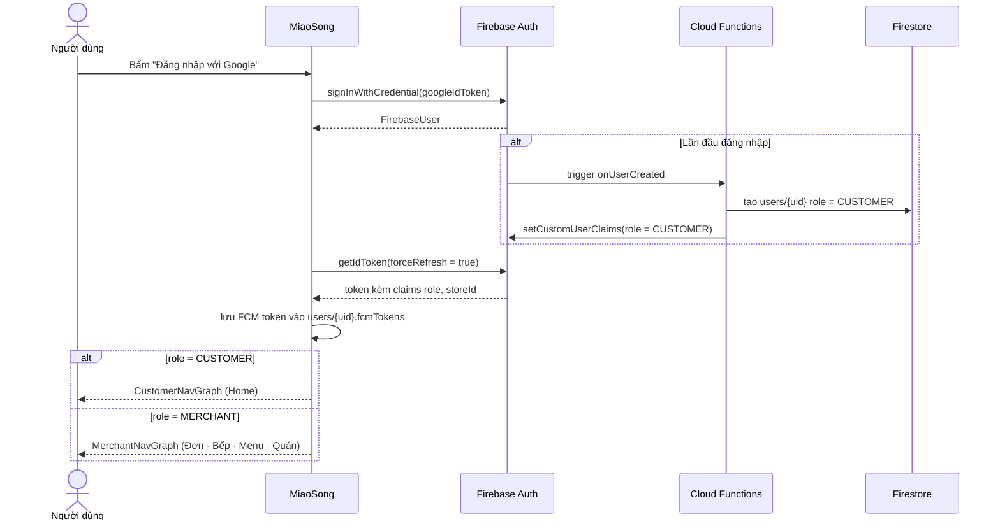

## SD-02 — Tùy chỉnh món & thêm vào giỏ

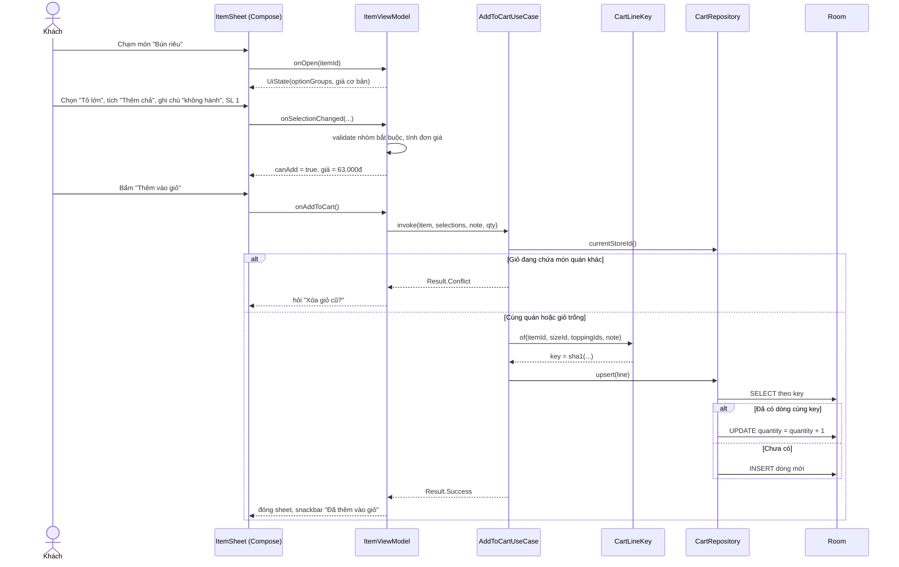

## SD-03 — Chọn địa chỉ & báo giá ship

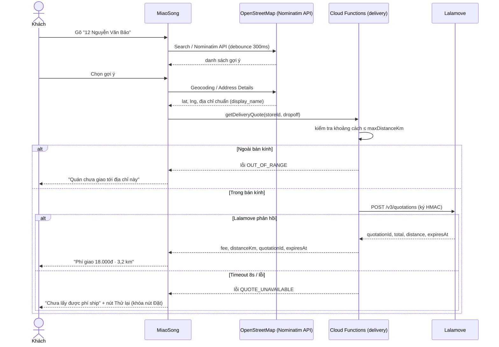

## SD-04 — Áp dụng voucher

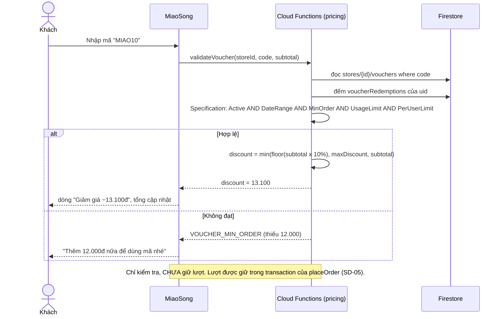

## SD-05 — Đặt đơn COD

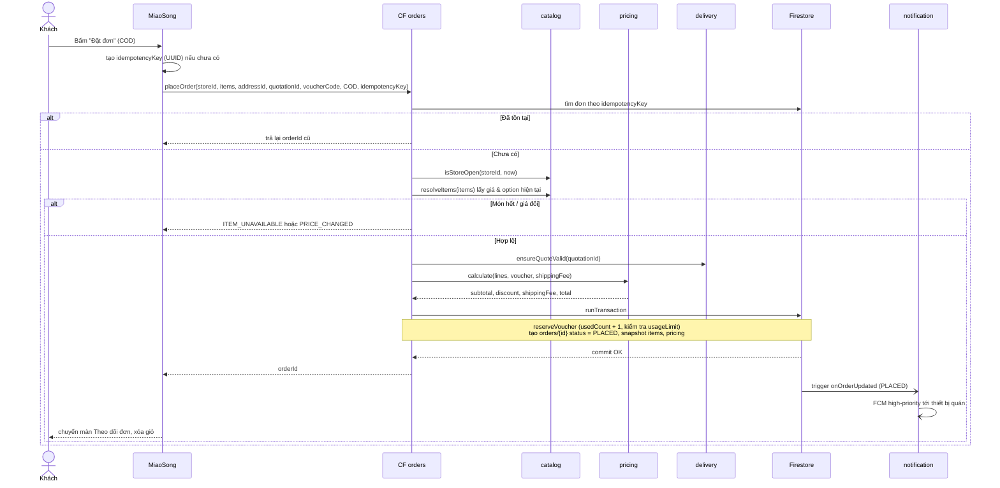

## SD-06 — Thanh toán ZaloPay

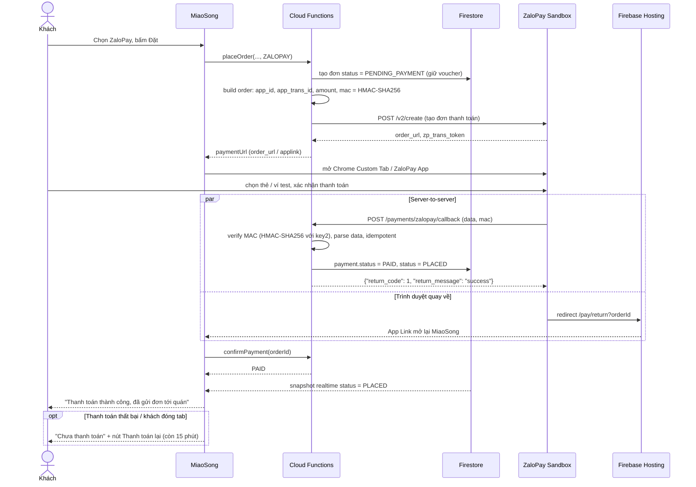

## SD-07 — Quán nhận & xác nhận đơn

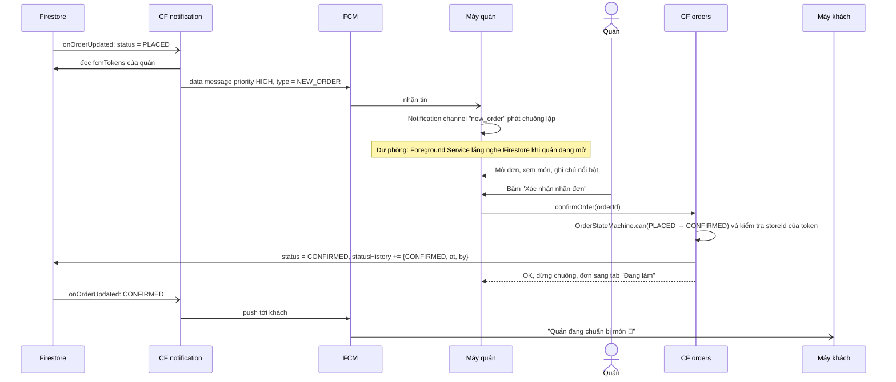

## SD-08 — Từ chối đơn & hoàn tiền

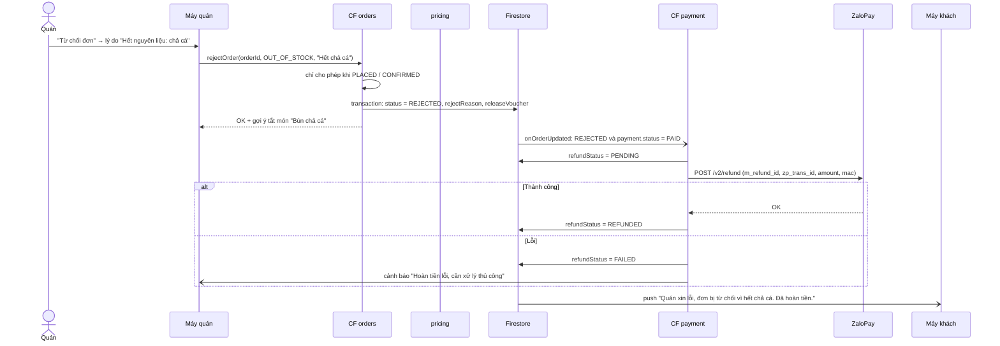

## SD-09 — Đóng gói tại bếp & gọi shipper

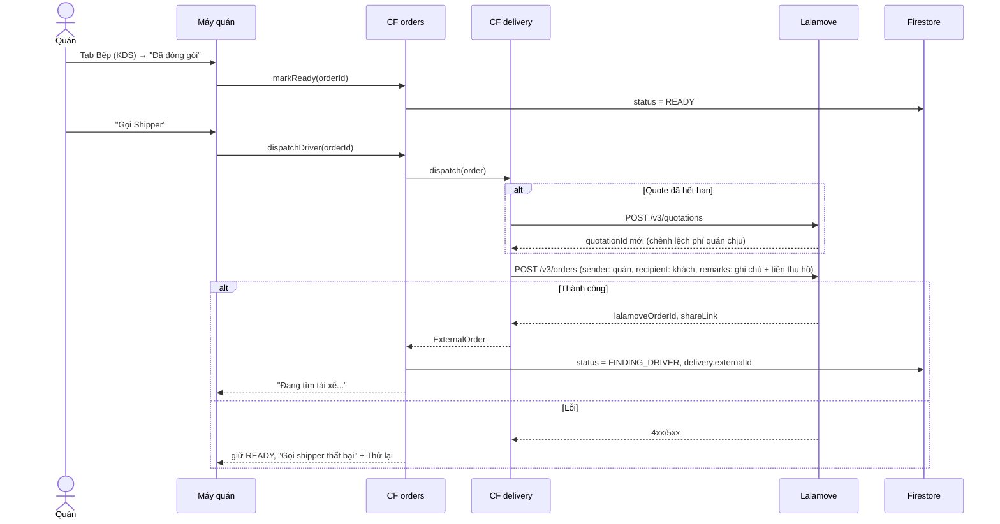

## SD-10 — Đồng bộ tài xế & trạng thái giao (webhook)

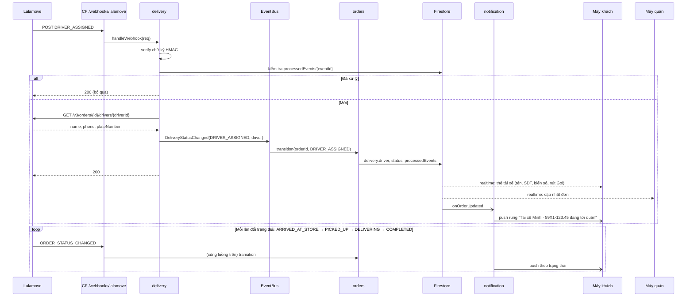

## SD-11 — Phát hiện đơn trễ & hủy đơn chưa thanh toán

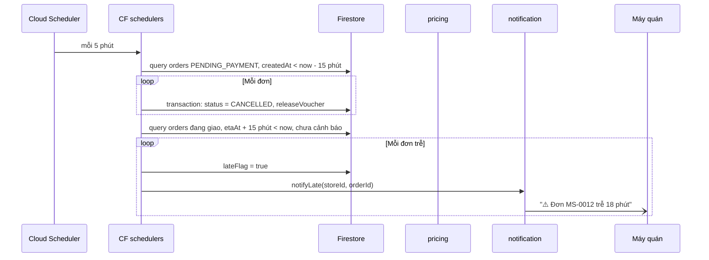

## SD-12 — Đánh giá đơn

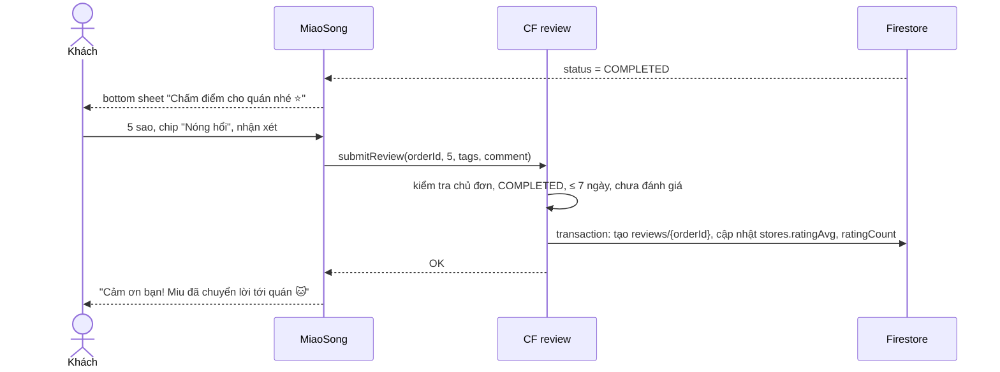

## SD-13 — Đặt lại đơn

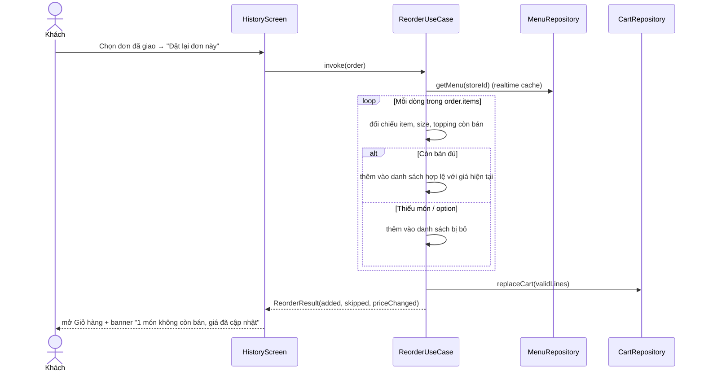

---

## SD-14 — Khách tự hủy đơn & hoàn tiền ZaloPay tự động

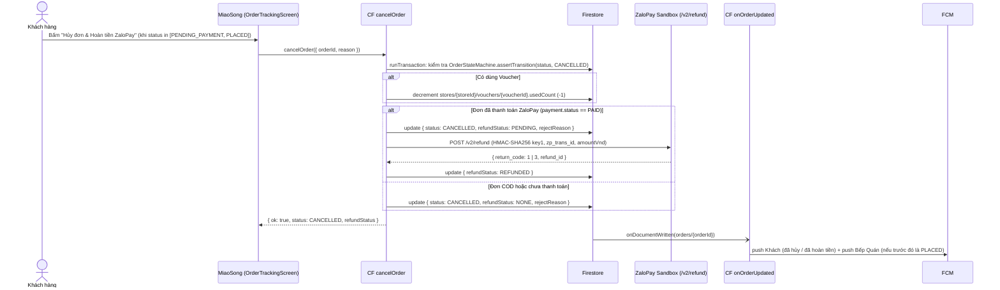

---

## SD-15 — Vận hành màn hình bếp (KDS) & đóng gói

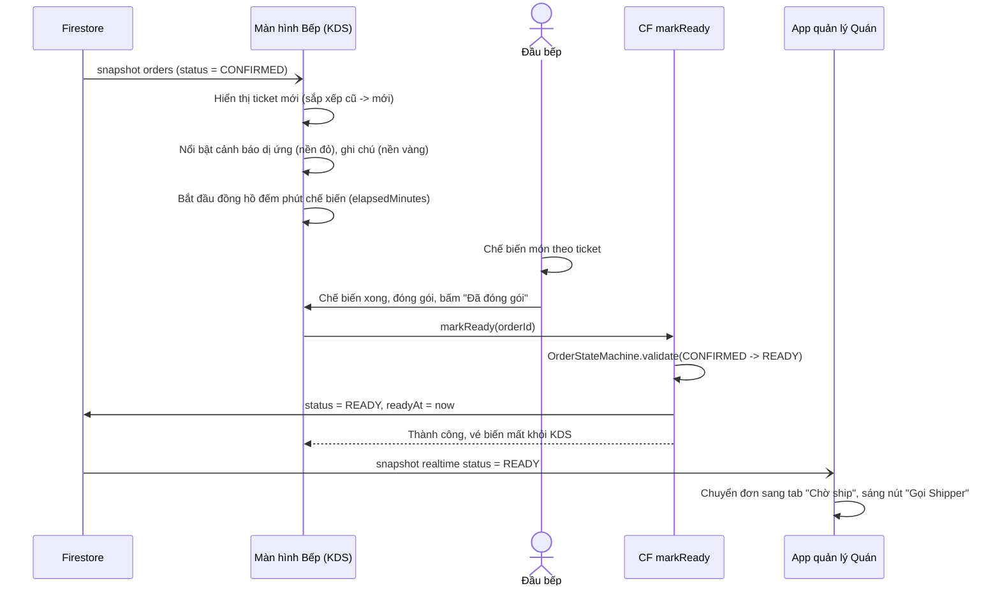

---

## SD-16 — Đổi trạng thái quán & lịch bận tức thời

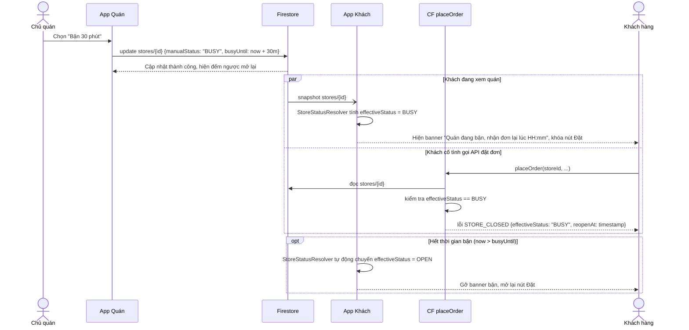

