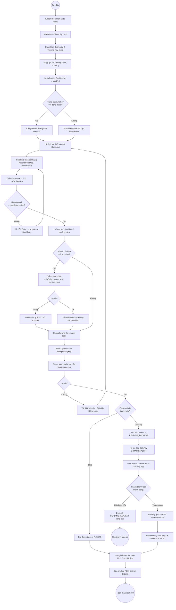
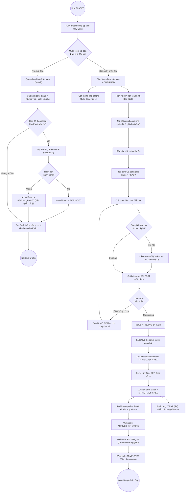
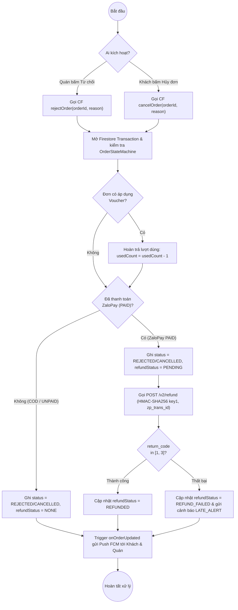
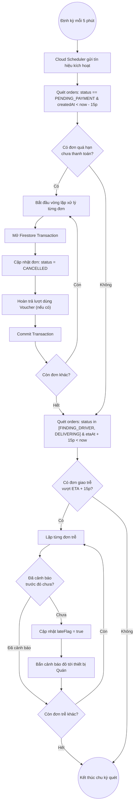
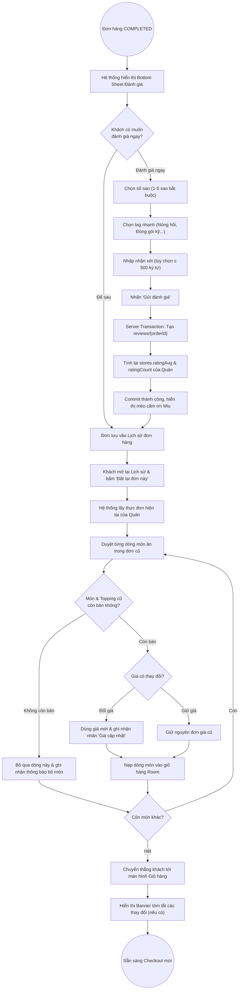

# 05 — Sơ đồ Hoạt động Toàn hệ thống (Activity Diagrams)

> **Dự án:** MiaoSong (喵送) — Nền tảng đặt món & điều phối giao hàng tự động (D2C F&B)  
> **Người phụ trách:** Nhóm phát triển MiaoSong  
> **Tài liệu liên quan:** [01-SRS.md](01-SRS.md) · [02-architecture.md](02-architecture.md) · [03-use-case-diagrams.md](03-use-case-diagrams.md) · [04-sequence-diagrams.md](04-sequence-diagrams.md) · [06-state-data-class.md](06-state-data-class.md)  
> **Tệp mã nguồn PlantUML:** [diagrams/05-activity-diagrams/activity.puml](diagrams/05-activity-diagrams/activity.puml)

---

## Mục lục
1. [Tổng quan Luồng hoạt động](#1-tổng-quan-luồng-hoạt-động)
2. [Activity Diagram 1: Luồng Đặt hàng, Báo giá Ship & Thanh toán](#2-activity-diagram-1-luồng-đặt-hàng-báo-giá-ship--thanh-toán)
3. [Activity Diagram 2: Luồng Tiếp nhận đơn, Vận hành Bếp (KDS) & Gọi Shipper Lalamove](#3-activity-diagram-2-luồng-tiếp-nhận-đơn-vận-hành-bếp-kds--gọi-shipper-lalamove)
4. [Activity Diagram 3: Luồng Hủy đơn / Từ chối đơn & Hoàn tiền tự động ZaloPay Sandbox](#4-activity-diagram-3-luồng-hủy-đơn--từ-chối-đơn--hoàn-tiền-tự-động-zalopay-sandbox)
5. [Activity Diagram 4: Luồng Tác vụ Nền Tự động hóa & Xử lý Đơn quá hạn (Cloud Scheduler)](#5-activity-diagram-4-luồng-tác-vụ-nền-tự-động-hóa--xử-lý-đơn-quá-hạn-cloud-scheduler)
6. [Activity Diagram 5: Luồng Đánh giá & Tái đặt hàng (Reorder)](#6-activity-diagram-5-luồng-đánh-giá--tái-đặt-hàng-reorder)

---

## 1. Tổng quan Luồng hoạt động

MiaoSong vận hành theo mô hình D2C F&B khép kín với sự phối hợp chặt chẽ giữa ứng dụng Khách hàng, ứng dụng Quán (tích hợp Bếp KDS), Backend Firebase và các đối tác bên thứ ba (Lalamove, ZaloPay, OpenStreetMap, FCM). 

Hệ thống biểu đồ hoạt động (Activity Diagrams) mô tả chi tiết:
* Trật tự các bước thực hiện của từng tác nhân theo làn (Swimlanes).
* Các điểm quyết định logic nghiệp vụ (Decision Nodes) và rẽ nhánh điều kiện (IF/ELSE).
* Cơ chế xử lý đồng thời (Fork/Join) và các luồng ngoại lệ (Hoàn tiền, Timeout, Hủy đơn).

---

## 2. Activity Diagram 1: Luồng Đặt hàng, Báo giá Ship & Thanh toán

Sơ đồ mô tả hành trình từ khi khách hàng chọn món, tùy biến topping, tính toán phí giao hàng theo km thực tế, thẩm định voucher, đến khi hoàn tất giao dịch qua COD hoặc ZaloPay Sandbox.

---

## 3. Activity Diagram 2: Luồng Tiếp nhận đơn, Vận hành Bếp (KDS) & Gọi Shipper Lalamove

Sơ đồ thể hiện quy trình xử lý của Quán ăn và Bếp, kết hợp điều phối chuyến giao hàng với Lalamove và đồng bộ trạng thái tài xế.

---

## 4. Activity Diagram 3: Luồng Hủy đơn / Từ chối đơn & Hoàn tiền tự động ZaloPay Sandbox

Sơ đồ mô tả tiến trình xử lý khi Quán từ chối đơn (`rejectOrder`) hoặc Khách tự hủy trước khi quán xác nhận (`cancelOrder`), đảm bảo hoàn trả lượt Voucher trong Transaction và tự động hoàn tiền qua ZaloPay Sandbox API.

---

## 5. Activity Diagram 4: Luồng Tác vụ Nền Tự động hóa & Xử lý Đơn quá hạn (Cloud Scheduler)

Sơ đồ thể hiện chu trình quét ngầm định kỳ của hệ thống máy chủ để đảm bảo tính toàn vẹn của dữ liệu và trải nghiệm khách hàng.

---

## 6. Activity Diagram 5: Luồng Đánh giá & Tái đặt hàng (Reorder)

Sơ đồ thể hiện trải nghiệm khách hàng sau khi nhận món ăn thành công: đánh giá chất lượng phục vụ và khả năng đặt lại đơn hàng cũ nhanh chóng mà không cần cấu hình lại từng món.

