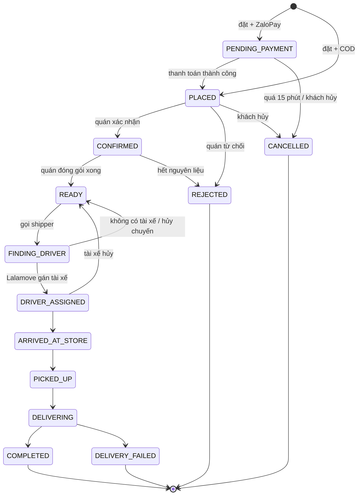
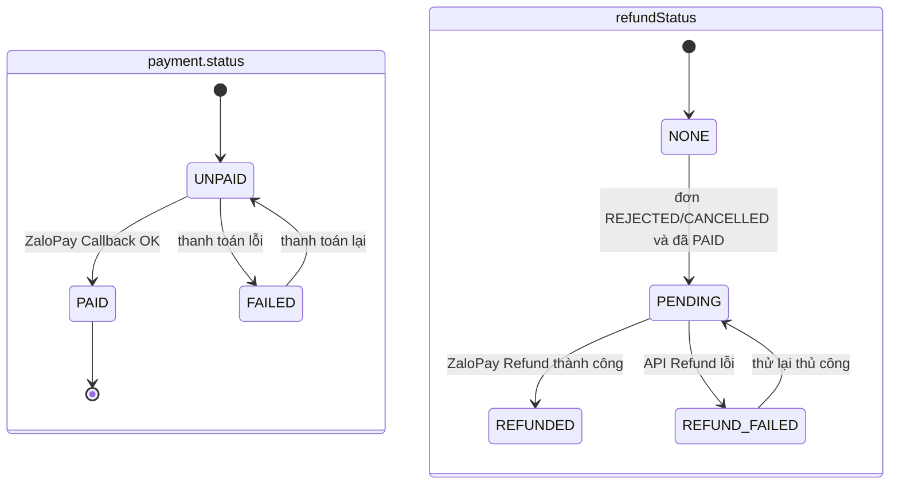
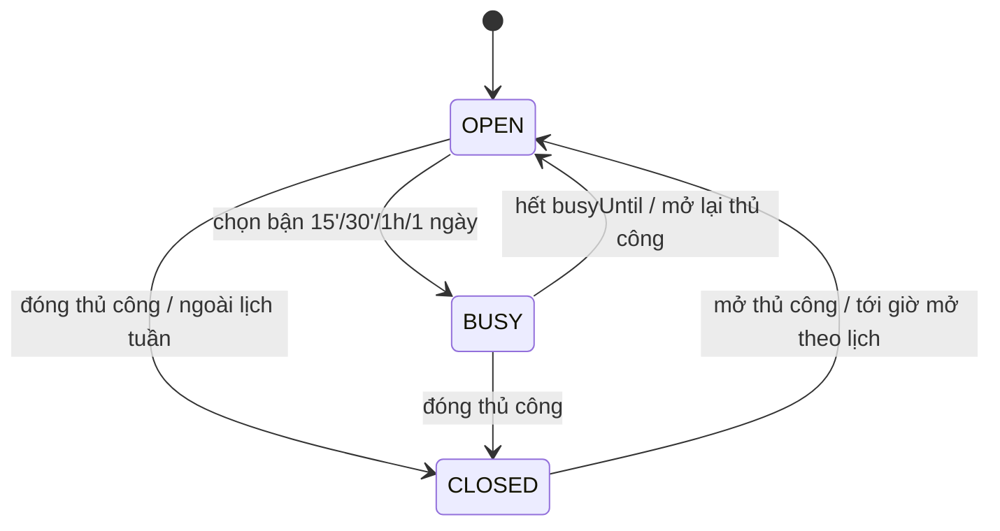
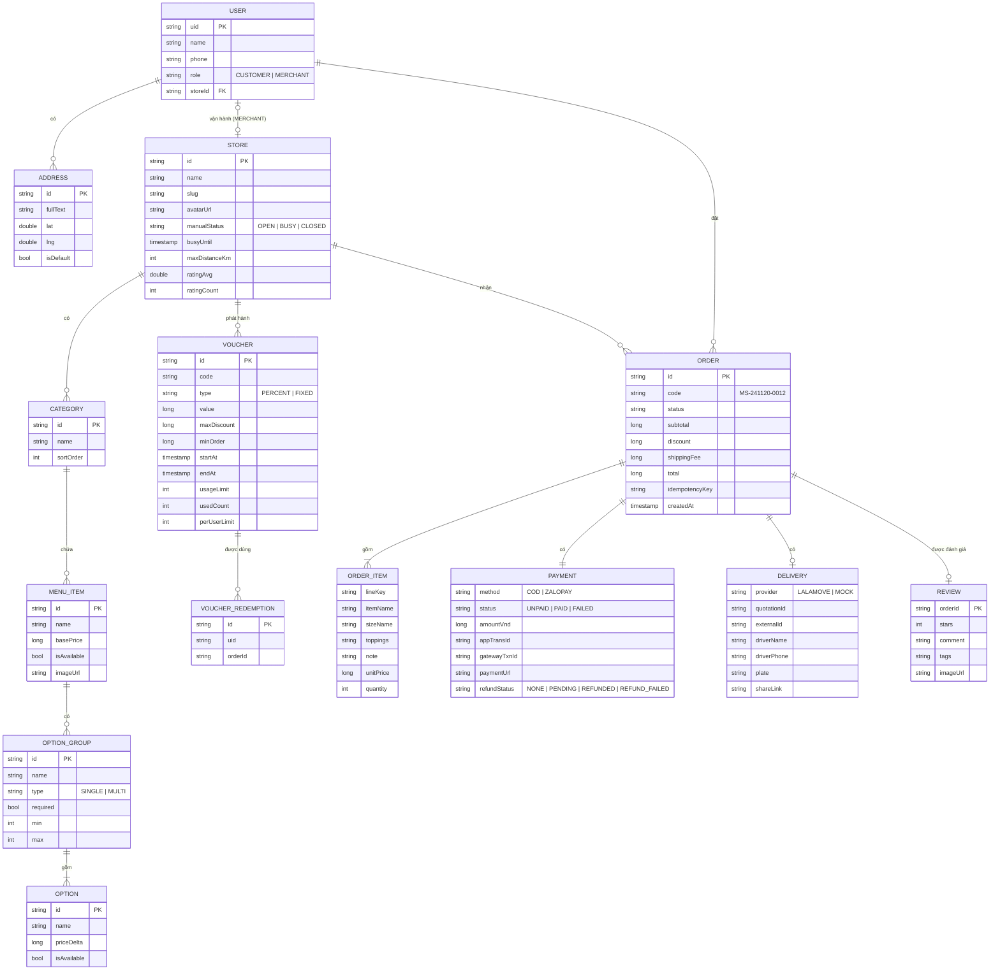
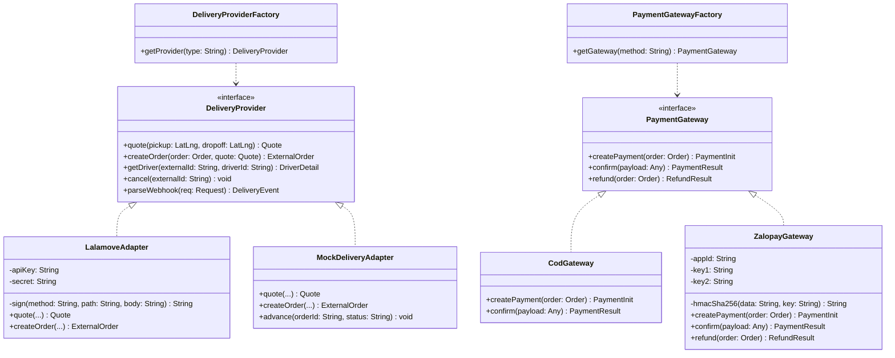
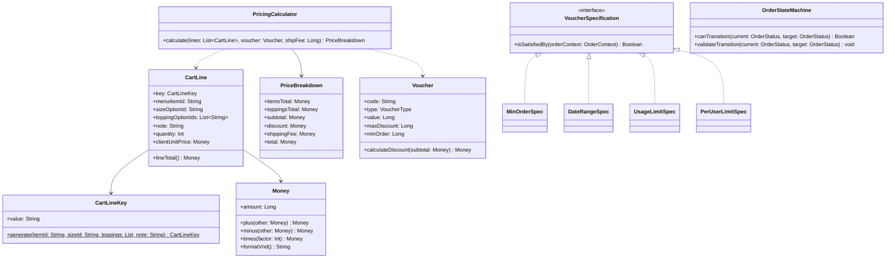
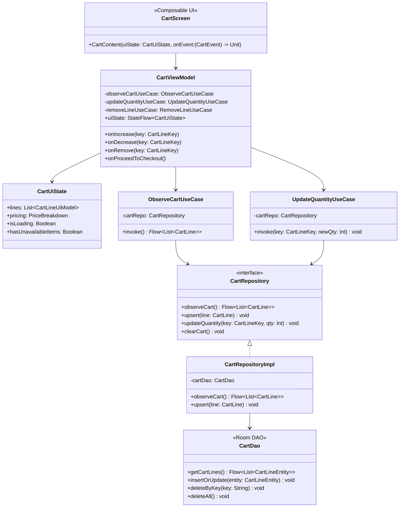
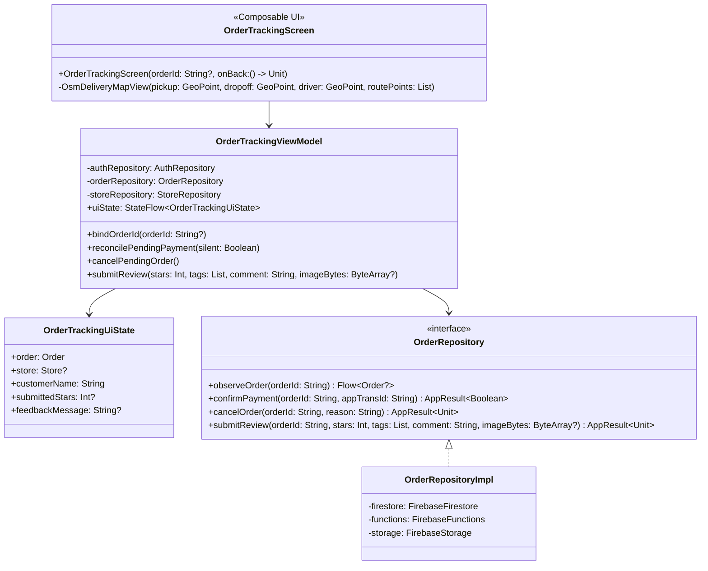
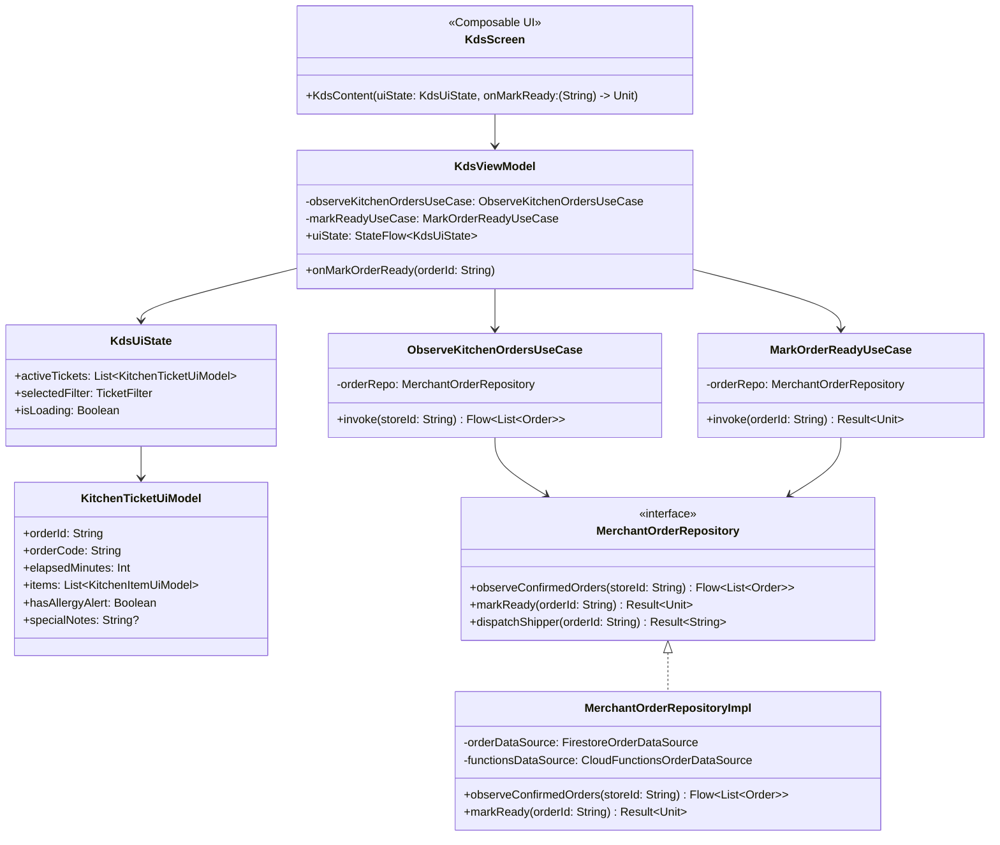

# 06 — State Machine, Data Model & Class Diagrams

> **Dự án:** MiaoSong (喵送) — Nền tảng đặt món & điều phối giao hàng tự động (D2C F&B)  
> **Người phụ trách:** Trương Minh Thành · Review: Huỳnh Trần Thiên Phú  
> **Tài liệu liên quan:** [01-SRS.md](01-SRS.md) · [02-architecture.md](02-architecture.md) · [03-use-case-diagrams.md](03-use-case-diagrams.md) · [04-sequence-diagrams.md](04-sequence-diagrams.md) · [05-activity-diagrams.md](05-activity-diagrams.md)  
> **Mã nguồn PlantUML:** [diagrams/06-state-data-class/class-diagrams.puml](diagrams/06-state-data-class/class-diagrams.puml)

---

## 1. State machine đơn hàng

**Bảng chuyển trạng thái (nguồn cho `OrderStateMachine`):**

| Từ | Sang | Ai kích hoạt |
|---|---|---|
| `PENDING_PAYMENT` | `PLACED` / `CANCELLED` | ZaloPay Callback / khách hủy, Cloud Scheduler (15p) |
| `PLACED` | `CONFIRMED` / `REJECTED` / `CANCELLED` | quán / quán / khách |
| `CONFIRMED` | `READY` / `REJECTED` | quán (chế độ Bếp) / quán (hết nguyên liệu) |
| `READY` | `FINDING_DRIVER` | quán (bấm Gọi Shipper) |
| `FINDING_DRIVER` | `DRIVER_ASSIGNED` / `READY` | Lalamove gán xe / tài xế hủy chuyến |
| `DRIVER_ASSIGNED` | `ARRIVED_AT_STORE` / `READY` | Lalamove Webhook |
| `ARRIVED_AT_STORE` | `PICKED_UP` | Lalamove Webhook |
| `PICKED_UP` | `DELIVERING` | Lalamove Webhook |
| `DELIVERING` | `COMPLETED` / `DELIVERY_FAILED` | Lalamove Webhook |

---

## 2. State machine thanh toán & hoàn tiền

---

## 3. State machine trạng thái quán

---

## 4. ERD (mô hình logic thực thể)

---

## 5. Ánh xạ Firestore (mô hình vật lý)

| Path Collection | Ghi bởi | Ghi chú & Ràng buộc bảo mật |
|---|---|---|
| `users/{uid}` | client (hồ sơ), CF (role) | Client không được sửa role/storeId |
| `users/{uid}/addresses/{id}` | client | Quản lý địa chỉ giao hàng |
| `stores/{storeId}` | MERCHANT (Rules) | `weeklySchedule`, `specialDays` nhúng trong doc |
| `stores/{storeId}/categories/{id}` | MERCHANT | Nhóm danh mục món ăn |
| `stores/{storeId}/menuItems/{id}` | MERCHANT | `optionGroups[]` nhúng trực tiếp trong document |
| `stores/{storeId}/vouchers/{id}` | MERCHANT | `usedCount` chỉ do Cloud Functions tăng trong transaction |
| `voucherRedemptions/{voucherId_uid_orderId}` | chỉ CF | Dùng kiểm soát `perUserLimit` |
| `orders/{orderId}` | **chỉ CF** | Cấm client ghi trực tiếp. Toàn bộ items, payment, delivery snapshot |
| `reviews/{orderId}` | chỉ CF | `id = orderId` đảm bảo 1 đơn chỉ đánh giá 1 lần (hỗ trợ `imageUrl` từ Storage) |
| `idempotencyKeys/{uid_key}` | chỉ CF | Chống tạo đơn trùng khi mạng chập chờn hoặc bấm Đặt nhiều lần |
| `processedEvents/{source_eventId}` | chỉ CF | Chống webhook/IPN gửi lặp (Idempotency) |

---

## 6. Class Diagram — Backend Hexagonal Architecture (Module `orders`)

Mô hình cấu trúc Ports & Adapters bên trong module `orders` — trung tâm điều phối toàn bộ vòng đời đơn hàng, cách ly hoàn toàn logic domain với Firebase SDK.

```mermaid
classDiagram
    class PlaceOrderUseCase {
        -orderRepo: OrderRepository
        -catalogPort: CatalogPort
        -pricingPort: PricingPort
        -paymentPort: PaymentPort
        -eventPublisher: EventPublisher
        +execute(cmd: PlaceOrderCommand) OrderResult
    }
    class TransitionOrderUseCase {
        -orderRepo: OrderRepository
        -eventPublisher: EventPublisher
        +execute(orderId: String, newStatus: OrderStatus) Result
    }
    class DispatchDriverUseCase {
        -orderRepo: OrderRepository
        -deliveryPort: DeliveryPort
        +execute(orderId: String) DeliveryResult
    }

    class OrderRepository {
        <<interface>>
        +findById(id: String) Order
        +save(order: Order) void
        +saveInTransaction(order: Order, tx: Transaction) void
    }
    class CatalogPort {
        <<interface>>
        +isStoreOpen(storeId: String, at: Timestamp) Boolean
        +resolveItems(itemIds: List) List~ItemSnapshot~
    }
    class PricingPort {
        <<interface>>
        +calculate(lines: List, voucherCode: String, shipFee: Long) PriceBreakdown
        +reserveVoucher(storeId: String, code: String, userId: String) void
    }
    class DeliveryPort {
        <<interface>>
        +quote(pickup: LatLng, dropoff: LatLng) Quote
        +createOrder(order: Order, quote: Quote) ExternalOrder
    }
    class PaymentPort {
        <<interface>>
        +createPayment(order: Order) PaymentInit
        +refund(order: Order) RefundResult
    }
    class EventPublisher {
        <<interface>>
        +publish(event: DomainEvent) void
    }

    class FirestoreOrderRepository {
        -db: Firestore
        +findById(id: String) Order
        +save(order: Order) void
    }
    class CatalogAdapter {
        +isStoreOpen(storeId: String, at: Timestamp) Boolean
    }
    class PricingAdapter {
        +calculate(...) PriceBreakdown
    }
    class InProcessEventBus {
        +publish(event: DomainEvent) void
    }

    PlaceOrderUseCase --> OrderRepository
    PlaceOrderUseCase --> CatalogPort
    PlaceOrderUseCase --> PricingPort
    PlaceOrderUseCase --> PaymentPort
    PlaceOrderUseCase --> EventPublisher
    TransitionOrderUseCase --> OrderRepository
    TransitionOrderUseCase --> EventPublisher
    DispatchDriverUseCase --> OrderRepository
    DispatchDriverUseCase --> DeliveryPort

    FirestoreOrderRepository ..|> OrderRepository
    CatalogAdapter ..|> CatalogPort
    PricingAdapter ..|> PricingPort
    InProcessEventBus ..|> EventPublisher
```

---

## 7. Class Diagram — Strategy Pattern cho Delivery & Payment (Backend)

Cấu trúc mở rộng cho phép cắm/rút nhà cung cấp vận chuyển (Lalamove, Mock) và cổng thanh toán (COD, ZaloPay) mà không thay đổi luồng cốt lõi.

---

## 8. Class Diagram — Domain Model Dùng Chung (Kotlin & TypeScript)

Các thực thể nghiệp vụ, Value Objects và thuật toán cốt lõi đảm bảo đồng nhất 100% giữa ứng dụng Android và Backend Functions.

---

## 9. Class Diagram — Android Clean Architecture: Feature Cart & Checkout

Kiến trúc UDF (Unidirectional Data Flow) của tính năng Giỏ hàng và Checkout phía Khách hàng.

---

## 10. Class Diagram — Android Clean Architecture: Feature Theo dõi Đơn & Bản đồ OSMDroid Realtime

Thiết kế phân lớp cho màn hình Theo dõi đơn hàng (`OrderTrackingScreen`), tích hợp bản đồ OpenStreetMap (OSMDroid) + tuyến đường bộ OSRM, đối soát thanh toán ZaloPay tự động và đánh giá kèm ảnh.

---

## 11. Class Diagram — Android Clean Architecture: Feature Quán & Bếp (KDS)

Mô hình phân lớp cho Màn hình Bếp (Kitchen Display System), hỗ trợ giữ sáng màn hình và lọc nổi bật món ăn có ghi chú dị ứng.

