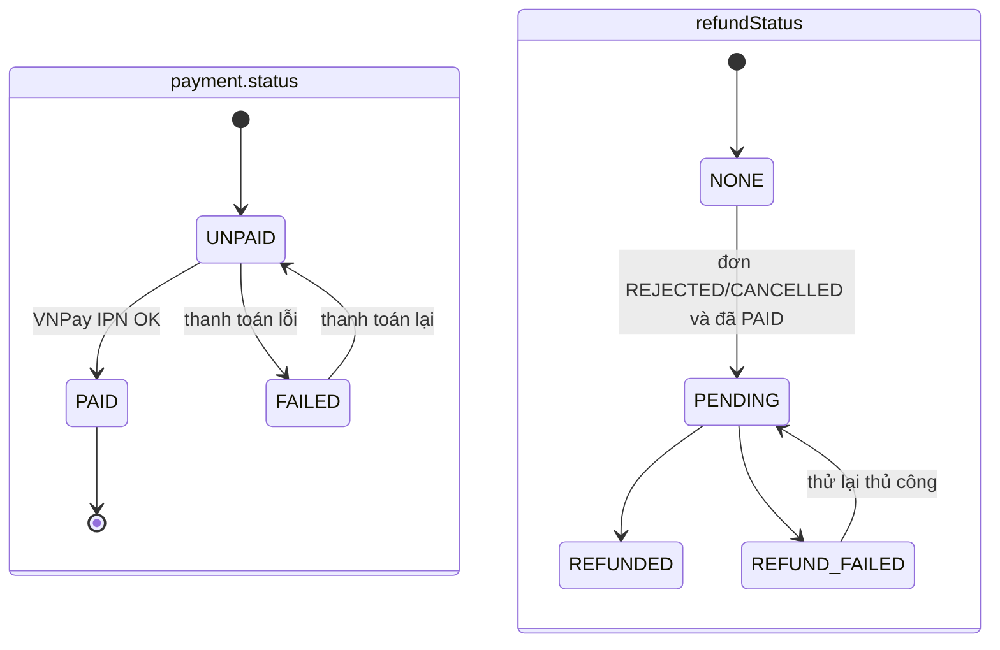
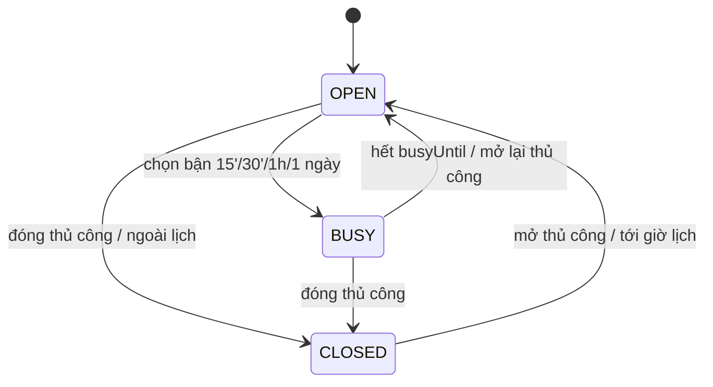
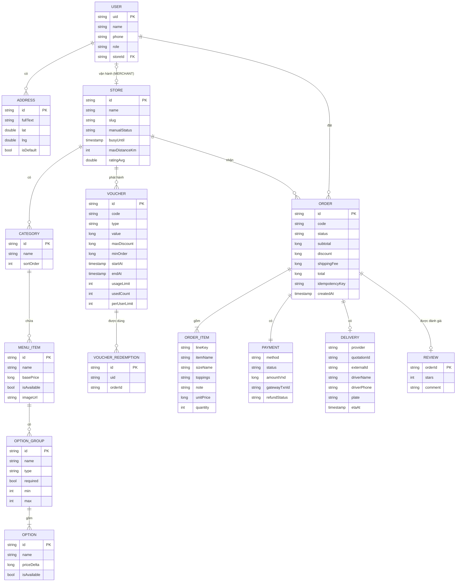
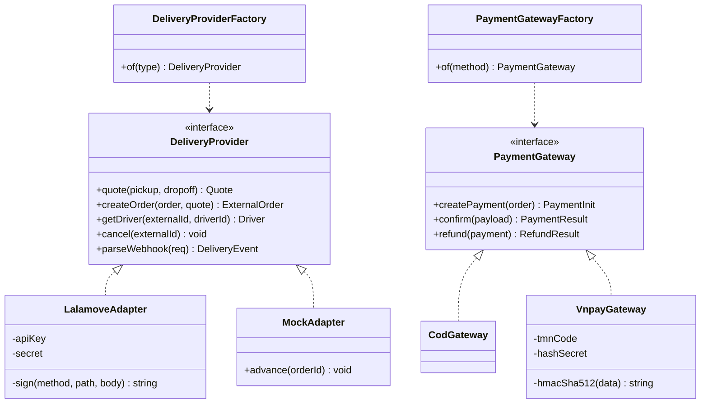
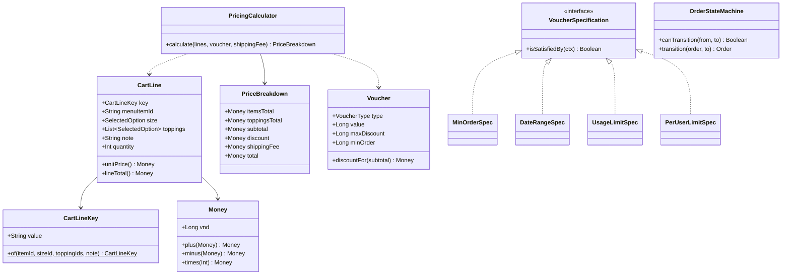
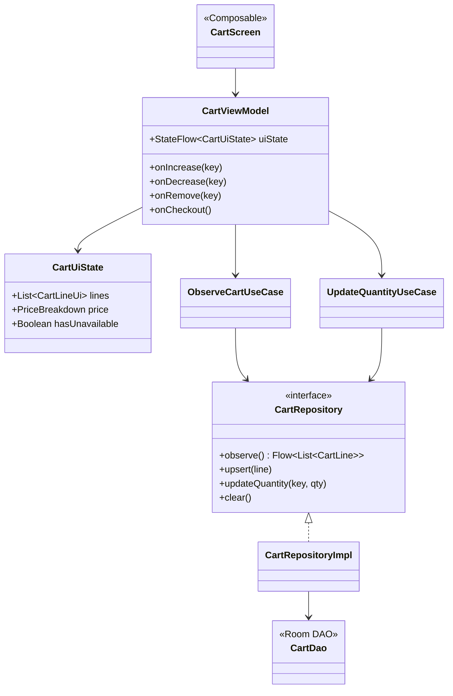

# 06 — State Machine, Data Model & Class Diagrams

> Phụ trách: **Thành** · Review: **Phú**

## 1. State machine đơn hàng

**Bảng chuyển trạng thái (nguồn cho `OrderStateMachine`):**

| Từ | Sang | Ai kích hoạt |
|---|---|---|
| PENDING_PAYMENT | PLACED / CANCELLED | payment / khách, scheduler |
| PLACED | CONFIRMED / REJECTED / CANCELLED | quán / quán / khách |
| CONFIRMED | READY / REJECTED | quán (chế độ Bếp) / quán |
| READY | FINDING_DRIVER | quán |
| FINDING_DRIVER | DRIVER_ASSIGNED / READY | Lalamove |
| DRIVER_ASSIGNED | ARRIVED_AT_STORE / READY | Lalamove |
| ARRIVED_AT_STORE | PICKED_UP | Lalamove |
| PICKED_UP | DELIVERING | Lalamove |
| DELIVERING | COMPLETED / DELIVERY_FAILED | Lalamove |

## 2. State machine thanh toán & hoàn tiền

## 3. State machine trạng thái quán

## 4. ERD (mô hình logic)

## 5. Ánh xạ Firestore (mô hình vật lý)

| Path | Ghi bởi | Ghi chú |
|---|---|---|
| `users/{uid}` | client (hồ sơ), CF (role) | |
| `users/{uid}/addresses/{id}` | client | |
| `stores/{storeId}` | MERCHANT (Rules) | `weeklySchedule`, `specialDays` nhúng trong doc |
| `stores/{storeId}/categories/{id}` | MERCHANT | |
| `stores/{storeId}/menuItems/{id}` | MERCHANT | `optionGroups[]` **nhúng** (đọc 1 lần là đủ) |
| `stores/{storeId}/vouchers/{id}` | MERCHANT, trừ `usedCount` (chỉ CF) | |
| `voucherRedemptions/{voucherId_uid_orderId}` | CF | đếm perUserLimit |
| `orders/{orderId}` | **chỉ CF** | `items[]`, `payment`, `delivery`, `statusHistory[]` nhúng |
| `reviews/{orderId}` | chỉ CF | id = orderId → đảm bảo 1 đơn 1 đánh giá |
| `processedEvents/{source_eventId}` | chỉ CF | idempotency |
| `config/payment` | admin | `pendingPaymentTtlMin` |

**Index cần tạo:** `orders(storeId, status, createdAt desc)` · `orders(customerId, createdAt desc)` · `orders(status, createdAt)` cho scheduler.

## 6. Class diagram — Strategy cho Delivery & Payment (backend)

## 7. Class diagram — Domain (dùng chung ý tưởng cho Kotlin & TypeScript)

## 8. Class diagram — Android (một feature tiêu biểu: Cart)

